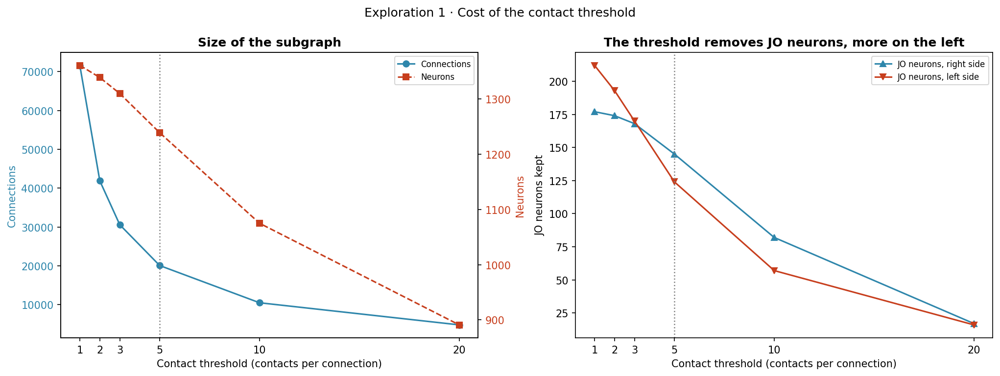
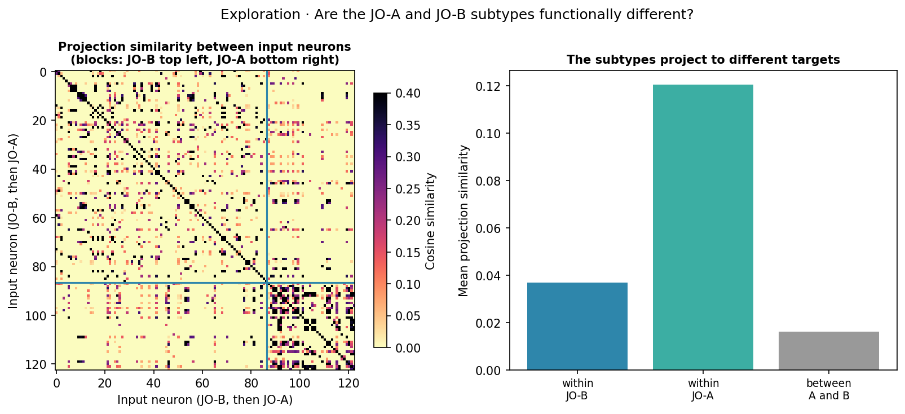
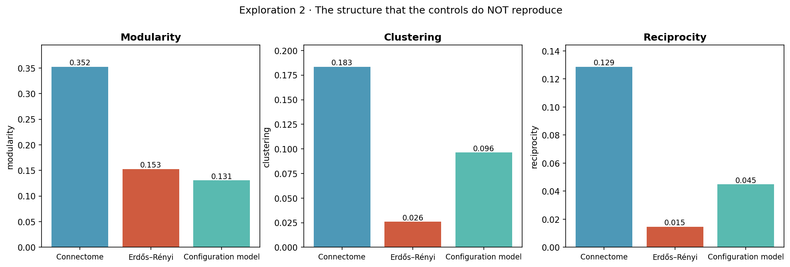
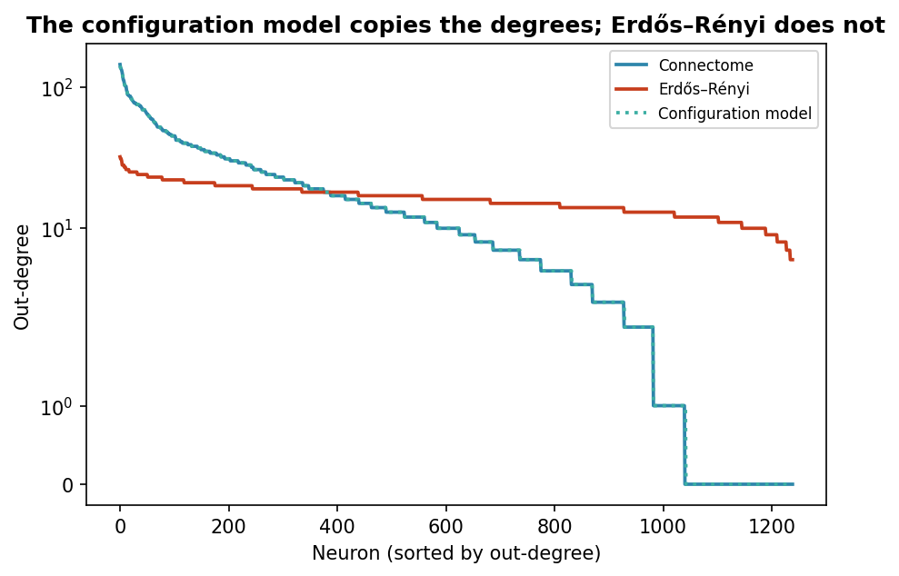
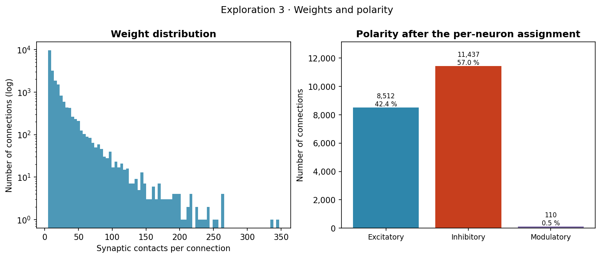

# Phase 02 results: the auditory subgraph of Johnston's organ

Notebook: [`01-exploratory-data-analysis.ipynb`](01-exploratory-data-analysis.ipynb) · Data produced: [`data/processed/`](../data/processed/) · History of the phase: [`research-log.md`](research-log.md)

This document reports what the data-understanding phase found and decided. It can be read on its own; the notebook has the code and every printed value.

---

## 1. Context and goal

The project asks whether a spiking neural network (a network whose neurons communicate through brief electrical events called spikes) learns a sound task better when it is wired like a real brain circuit than when it is wired at random. The wiring comes from a **connectome**, a map of every neuron of a brain and of the connections between them, reconstructed from electron-microscopy images. We use FlyWire, the public connectome of a whole adult fruit-fly brain (Dorkenwald et al., 2024; Schlegel et al., 2024). It was traced in a complete electron-microscopy volume of that brain (Zheng et al., 2018).

The circuit we need is the one behind hearing. **Johnston's organ** (JO) is the ear of the fly. It sits in the antenna, and its sensory neurons respond when sound or air currents move the antenna. The goal of this phase is to isolate the JO neurons and the neurons they talk to. Every filtering step is decided with the data in view, and the phase ends with a single, documented subgraph that phases 03 to 06 can simulate. In CRISP-DM terms (Chapman et al., 2000) this is data understanding; in the KDD process (Fayyad et al., 1996) it is the selection of the target data.

Two terms run through the whole repository.

- A **synaptic contact** (a synapse) is one physical site where a neuron passes a signal to another. FlyWire detects contacts automatically in the images (Buhmann et al., 2021; Heinrich et al., 2018).
- A **connection** is a directed pair of neurons, A → B, and its **weight** is the number of contacts from A onto B. In graph language a neuron is a **node** and a connection is an **edge**.

## 2. Data and provenance

We use FlyWire release **v783**, a frozen snapshot of the reconstruction, downloaded from Codex, the FlyWire data portal (Matsliah et al., 2023). Three files go in. `classification.csv.gz` holds the hierarchical annotation of each neuron (Dorkenwald et al., 2024; Schlegel et al., 2024). `consolidated_cell_types.csv.gz` holds cell types (Deutsch et al., 2025; Matsliah et al., 2024; Schlegel et al., 2024). `connections_buhmann_no_threshold.csv.gz` lists the connections per neuropil, with their synapse count (Buhmann et al., 2021; Heinrich et al., 2018) and the predicted neurotransmitter (Eckstein et al., 2024). A **neuropil** is a dense region of the brain where neurons make their contacts. Licensing, download dates and the full data credits are in [`data/README.md`](../data/README.md).

The files carry no version column, so we checked the release by counting.

| Quantity | Measured | Published for v783 |
|---|---|---|
| Annotated neurons | 139,255 | 139,255 |
| Rows of the connection file (pre → post → neuropil) | 16,847,997 | not reported |
| Synapses (sum of the file) | 54,492,922 | 54.5 million |

Both counts agree with the publication (Dorkenwald et al., 2024). Before release, FlyWire removed every synapse whose cleft score, a confidence value of the detector, was 50 or less, so that quality filter is already in the data. The file does not apply any minimum number of contacts per connection. That threshold is decided in this phase.

## 3. Identifying the circuit

In the FlyWire hierarchy the auditory JO neurons carry the labels `sensory / mechanosensory / auditory`. There are **393** of them, 214 on the left side of the brain and 179 on the right. All are afferent, meaning that they carry signals into the brain, and all run in the antennal nerve. A second annotation table, the cell-type table, agrees with the choice. The `auditory` subclass is exactly the set of neurons typed JO-A or JO-B, the subgroups that respond to vibration and sound (Kamikouchi et al., 2009). The subgroups that respond to static deflection of the antenna by gravity and wind, JO-C and JO-E (Kamikouchi et al., 2009; Yorozu et al., 2009), are labeled `wind_gravity` and stay out. So does JO-D, a small group that responds to both (Matsuo et al., 2014).

The circuit is the JO neurons plus their **partners**, the 972 neurons that receive at least one contact from a JO neuron, with every connection among them. That makes 1,365 neurons to start with. Limiting the set to direct postsynaptic partners keeps the network anchored to the sensory input. It also leaves out neurons that only send input to the set, and the deeper stages of the auditory pathway.

## 4. Contact threshold

A connection between two neurons can be spread over several neuropils and appear as several rows of the file. Its weight is the sum of contacts over all of them, so we merged the rows before applying any threshold. The **108,374** internal rows collapse into **71,621** distinct connections (a factor of 1.51).

| Threshold (contacts) | Connections | Neurons | JO neurons kept | JO left | JO right | Contacts |
|---|---|---|---|---|---|---|
| 1 | 71,621 | 1,361 | 389 | 212 | 177 | 426,087 |
| 2 | 41,881 | 1,339 | 367 | 193 | 174 | 396,347 |
| 3 | 30,569 | 1,310 | 338 | 170 | 168 | 373,723 |
| **5** | **20,059** | **1,239** | **269** | **124** | **145** | **338,013** |
| 10 | 10,475 | 1,075 | 139 | 57 | 82 | 275,227 |
| 20 | 4,777 | 891 | 33 | 16 | 17 | 198,660 |

With a threshold of 1 the graph keeps 1,361 neurons, four fewer than the starting 1,365, because four JO neurons have no connection inside the subgraph.

### Why five contacts

Synapses in FlyWire were detected automatically and not proofread one by one. Validation of the detector gave a precision of 0.72 and a recall of 0.77 (Buhmann et al., 2021). A connection supported by one or two contacts is therefore the most likely to be spurious. Dorkenwald et al. (2024) keep connections with at least five synapses in their own analyses, and Codex applies the same threshold by default. They also call the value "reasonable but arbitrary" and recommend adapting it to each analysis. We therefore measured what it costs here.

The weight of the 71,621 merged connections is very unevenly spread.

| Contacts per connection | Share of connections | Share of contacts |
|---|---|---|
| exactly 1 | 41.5 % | 7.0 % |
| exactly 2 | 15.8 % | 5.3 % |
| exactly 3 | 8.8 % | 4.5 % |
| exactly 4 | 5.8 % | 3.9 % |
| **5 or more** | **28.0 %** | **79.3 %** |

Single-contact connections are 41.5 % of the connections but carry only 7.0 % of the contacts. The threshold removes most of the likely noise and keeps 79.3 % of the synaptic contacts.

Phase 04 then tested the choice by running the task. It rebuilt the subgraph at thresholds of 1, 3, 5 and 10 contacts, recalibrated every network and ran the whole experiment with three seeds per network ([modeling results](../04-modeling/results.md)). Accuracy there is the fraction of test songs that the network classifies correctly, with a chance level of 0.200 for the five songs. Removing the threshold did not help. With no threshold the connectome network with learning reached 0.727 accuracy, against 0.863 at five contacts (three seeds; the main experiment, with fifteen, gives 0.875), even though it had 2.7 times more input neurons. At three contacts it scored a little higher (0.903), and its advantage over the Erdős–Rényi control of Section 9 looked larger (+0.680 against +0.397 at five), but mostly because the control got worse (0.223 against 0.467). The advantage holds at every threshold where both networks could be calibrated, with +0.370 at ten contacts. Without a threshold the random network could not be brought to the common operating point.

We kept **at least 5 contacts per connection**. The value was fixed before running any model, which keeps it independent of the results. Its cost is measured. The graph loses **124 of the 393 annotated JO neurons (31.6 %)**, or **120 of the 389 that have at least one connection (30.8 %)**, and we always give the base. The loss is also **uneven between sides**, −41.5 % on the left against −18.1 % on the right, both measured from the threshold of 1.

The FlyWire papers report a similar reconstruction completeness in both hemispheres (Dorkenwald et al., 2024), so they do not explain the left–right difference. Technical causes are possible. The JO neurons of the two hemispheres were annotated in different detail, and sample artifacts are more frequent in sensory neurons (Schlegel et al., 2024). Biological variability cannot be ruled out. We treat the imbalance as a limitation, because it shapes the input layer (Section 7).

**The resulting graph has 1,239 neurons, 20,059 connections and 338,013 synaptic contacts, with 269 JO neurons.**

## 5. Neurotransmitter and polarity

FlyWire predicts the neurotransmitter of every synapse with a classifier that reads the electron-microscopy image (Eckstein et al., 2024). A simulation needs the **polarity** of each connection instead. An excitatory connection pushes its target towards firing and an inhibitory one holds it back. A modulatory connection, in biology, slowly changes how strongly its target responds. We follow the sign convention of Dorkenwald et al. (2024). Acetylcholine (ACH) is excitatory, and GABA and glutamate (GLUT) are inhibitory. In most known synapses of the *Drosophila* central brain, glutamate inhibits through GluClα chloride channels (Eckstein et al., 2024; Liu & Wilson, 2013). That is unlike its mainly excitatory role in vertebrates, although excitatory glutamate transmission also exists in flies. Serotonin (SER), dopamine (DA) and octopamine (OCT) go to a separate modulatory channel, a choice of this project that phase 03 examines.

**The predictions disagree within neurons.** Dale's principle states that a neuron releases the same transmitter, or set of transmitters, at all its terminals (Eccles, 1976; Svensson et al., 2019). In the data, 1,183 of the 1,303 presynaptic neurons of the subgraph (90.8 %) carry more than one label. Even single neuron pairs disagree, since 6,656 of the 71,621 pairs (9.3 %) get different labels in different neuropils. The classifier works synapse by synapse and makes mistakes. Taking the label of the first row of the file would make part of the graph depend on the row order.

We assign **one transmitter per presynaptic neuron**, the majority of its synapses over the whole connectome, weighted by synapse count and with ties broken in a fixed order, as Eckstein et al. (2024) do for their neuron-level predictions. The **purity** of a neuron is the fraction of its synapses that agree with the winner. Over 138,005 neurons the mean purity is 0.866, and 3,631 neurons fall below 0.5. Compared with the first-row label, **1,258 connections of the final graph (6.3 %) change sign**.

**Cholinergic prior for the JO afferents.** Most JO neurons are cholinergic (Ishikawa et al., 2017), but the classifier mislabels some first-order sensory neurons, often as serotonergic (Eckstein et al., 2024). In the final graph, 64 of the 960 connections that leave JO neurons (6.7 %, with 6.6 % of their contacts) were predicted as serotonin or GABA. We set every connection whose presynaptic neuron is a JO neuron to acetylcholine and leave all other predictions as they are. The column `nt_source` of `jo_edges.csv` marks those connections. The prior is applied before the threshold, on the 71,621 merged connections, where it reassigns **757** connections; this is the value stored in `jo_meta.json`. The 64 are the ones that remain in the final graph. JO neurons also form electrical synapses with some central targets (Azevedo & Wilson, 2017; Pézier et al., 2016), which a connectome of chemical synapses does not contain.

| Polarity | Connections | Share |
|---|---|---|
| Inhibitory | 11,437 | 57.0 % |
| Excitatory | 8,512 | 42.4 % |
| Modulatory | 110 | 0.5 % |

The **E/I ratio**, excitatory connections divided by inhibitory ones, is **0.7443**. Inhibition dominates the circuit. Modulatory connections are rare once the transmitter is estimated per neuron, because the per-synapse serotonin, dopamine and octopamine labels scattered over the graph average out.

## 6. Topological structure

**Topology** is the pattern of who connects to whom, regardless of the weights. We computed these metrics on the directed graph and, where noted, on its undirected version.

| Metric | Value | What it measures |
|---|---|---|
| Neurons (nodes) | 1,239 | |
| Connections (edges) | 20,059 | |
| JO neurons | 269 | |
| Input layer | 123 | JO neurons with an outgoing connection (Section 7) |
| Density | 0.0131 | fraction of all possible directed connections that exist |
| Mean degree | 16.1897 | connections per neuron |
| Reciprocity | 0.1287 | fraction of connections A → B for which B → A exists |
| Mean clustering | 0.1835 | how often two neighbors of a neuron are connected to each other (undirected) |
| Weakly connected components | 1 | pieces that cannot reach each other even ignoring direction |
| Communities (Louvain) | 5 | groups found by the Louvain method (Blondel et al., 2008), seed 42 |
| **Modularity Q** | **0.3524** | strength of that split into groups (Newman, 2006) |
| E/I ratio | 0.7443 | excitatory divided by inhibitory connections |

**Modularity carries the most weight.** A value of 0.3524 means that the circuit is organized in blocks densely wired inside and loosely wired between them. Random wiring does not produce that, and Section 9 shows that neither control reproduces it. It is the concrete structure that phase 04 puts to the test. The graph is also a single weakly connected component, so it has no isolated islands.

## 7. The input layer

A JO neuron can pass the stimulus on only if it has at least one **outgoing** connection; its **out-degree**, the number of outgoing connections, must be above zero.

- **123 of the 269 JO neurons (45.7 %) have an outgoing connection.**
- The other **146 (54.3 %)** only receive connections. They stay in the graph because central neurons send them feedback.
- There are **no JO → JO connections**. The graph has 960 JO → partner connections, 698 partner → JO feedback connections and 18,401 partner → partner connections. The entry pathway is 4.8 % of the circuit, the feedback onto JO neurons 3.5 %, and the central processing between partners the remaining 91.7 %.
- The 960 outgoing JO connections come from the 123 input neurons, 7.8 per neuron on average and 33 at most.
- The feedback onto JO neurons is almost all inhibitory (683 of the 698 connections; 12 are excitatory and 3 modulatory), and 331 of those connections reach the 146 JO neurons without outputs.

The **input layer** is therefore the 123 JO neurons with outgoing connections, 82 on the right side and 41 on the left. The 146 others remain in the network, since the feedback they receive is real, but they receive no stimulus. This has a practical side. In phase 04 a bank of 32 band-pass filters splits the sound into frequency channels, and each channel drives a block of input neurons. Spread over the 123 neurons of the input layer, every channel drives 3 or 4 of them. Spread over all 269 JO neurons, some channels would drive many more useful neurons than others.

## 8. JO-A and JO-B subtypes and the frequency mapping

`classification.csv.gz` groups the two sound-sensitive subtypes under the single label `auditory`; the 393 neurons share every column except `side`. The distinction comes from `consolidated_cell_types.csv.gz`, which types **all 393** neurons, **299 JO-B and 94 JO-A**, with no missing value.

| | JO-A | JO-B |
|---|---|---|
| In the graph (269) | 82 | 187 |
| **Input layer (123)** | **36** | **87** |
| right side | 29 | 53 |
| left side | 7 | 34 |

### The subtypes project to different targets

A label is useful only if it matches a real difference. For each input neuron we built its projection profile, the number of contacts it makes onto each partner, and compared profiles with the cosine similarity (1 means the same targets in the same proportions, 0 means no shared target).

| Comparison | Mean similarity |
|---|---|
| Within JO-A | 0.1205 |
| Within JO-B | 0.0369 |
| **Between JO-A and JO-B** | **0.0163** |

The similarity within a subtype (the mean of the two within-subtype values) is **4.84 times** the similarity between subtypes. The absolute values are low because each JO neuron contacts only a few of the 970 partners left in the graph, so most pairs share no target; the ratio is what measures segregation. The split of contacts by neuropil (computed on the connections of the final graph) shows where the difference lies. AMMC (antennal mechanosensory and motor center), SAD (saddle) and AVLP (anterior ventrolateral protocerebrum) are neuropils of the auditory pathway, and the suffixes R and L mark the right and left hemispheres.

| Neuropil | JO-A | JO-B |
|---|---|---|
| AMMC_R | 48.2 % | 34.7 % |
| AMMC_L | 10.6 % | 24.0 % |
| SAD | 27.9 % | 39.9 % |
| **AVLP_R** | **10.4 %** | **0.7 %** |

JO-A has a route to AVLP_R that JO-B barely uses, and JO-B sends a larger share of its contacts to SAD. Its larger share in the left AMMC is a matter of side rather than subtype. Each neuron sends most of its contacts to the AMMC of its own side, and JO-B has proportionally more neurons on the left (34 of 87, against 7 of 36 for JO-A). Within each side, the two subtypes still project to different targets.

This segregation supports anchoring the frequency mapping on anatomy. JO-B prefers low-frequency vibrations and JO-A carries the high-frequency responses (Kamikouchi et al., 2009; Matsuo et al., 2014), so the low filterbank channels go to JO-B neurons and the high ones to JO-A neurons. With 87 and 36 neurons, JO-B covers 80–271 Hz and JO-A 271–380 Hz, and the 271 Hz channel is shared by both. Within each subtype the neurons follow their FlyWire identifier (`root_id`). The anchor is coarse, with two levels only.

Phase 04 checked how much the mapping matters by repeating the experiment with four mappings (anchored, anchored but inverted, `root_id` order and random). The connectome network that learns with spike-timing-dependent plasticity (STDP, a local learning rule) stayed between 0.880 and 0.920 accuracy with all of them, and the anchored mapping was the least favorable of the four. The main results use it for that reason, as the conservative choice.

### The earlier proxy, for reference

Before the cell-type table was available, the mapping relied on the `root_id` order, which keeps some spatial locality from the segmentation. A permutation test with 5,000 random orders measured how similar neighbors are in that order.

| Order | Mean similarity between neighbors |
|---|---|
| By `root_id` | 0.0671 |
| Random (mean ± standard deviation over 5,000 orders) | 0.0353 ± 0.0101 |

The `root_id` order is above chance (**p = 0.0024**, the fraction of random orders that do at least as well), so the proxy was real but weak. It remains the secondary order inside each subtype and one of the four mappings compared in phase 04.

## 9. Control topologies

To isolate the effect of the wiring we generated two control networks. They share with the connectome the number of neurons, the number of connections of each polarity and the weight distribution of each polarity. Only the pattern of who connects to whom differs. Both come from `snnlib/graph.py`.

- **Erdős–Rényi** (Erdős & Rényi, 1959) places the connections uniformly at random, with no self-connections and no duplicates within a polarity.
- The **configuration model** (Molloy & Reed, 1995; Newman et al., 2001) also keeps the **degree sequence**, the number of connections that enter and leave each neuron. It shuffles the endpoints of the connections and rewires the few that would create self-connections or duplicates.

| | Connectome | Erdős–Rényi | Configuration model |
|---|---|---|---|
| Simulated connections | 20,059 | 20,059 | 20,059 |
| Distinct edges | 20,059 | 19,994 | 20,059 |
| Density | 0.0131 | 0.0130 | 0.0131 |
| **Out-degree correlation with the connectome** | 1.0000 | **0.0142** | **1.0000** |
| Mean clustering | 0.1835 | 0.0260 | 0.0963 |
| **Modularity Q** | **0.3524** | 0.1528 | **0.1307** |
| Reciprocity | 0.1287 | 0.0147 | 0.0450 |
| Communities (Louvain) | 5 | 10 | 10 |

Values from the notebook, with seed 0 for the control wiring and seed 42 for Louvain. A seed fixes the random number generator, so the same networks and communities come out on every run.

Erdős–Rényi shows **19,994 distinct edges instead of 20,059** because the connections of each polarity are drawn separately. **65 pairs of neurons receive two connections of different polarity**, and the directed graph counts each pair once. The number of simulated connections is still 20,059 in all three networks, and that is what makes the comparison fair.

The configuration model reproduces the degree sequence, yet it keeps only about half of the clustering (0.0963 against 0.1835) and **37 % of the modularity** (0.1307 against 0.3524). In modularity it even falls **below the Erdős–Rényi graph**. So the organization of the connectome is not explained by a few neurons concentrating many connections; there is structure in how the neurons link to each other.

The copy of the degrees is **almost** exact. The endpoints that the shuffle cannot place without a self-connection or a repeated pair are closed with random valid targets. The out-degree correlation with the connectome is 0.999983, and 10 of the 1,239 neurons deviate by 3 connections at most (the largest out-degree is 141 instead of 144). In-degrees are copied as closely (correlation 0.999985). The difference is negligible for the comparison.

This is why the configuration model is the demanding control. If the biological network also beats it, the advantage cannot come from the spread of degrees alone.

## 10. Synaptic weights

| Statistic (contacts per connection) | Value |
|---|---|
| Minimum | 5.00 |
| Median | 10.00 |
| Mean | 16.85 |
| 95th percentile | 51.00 |
| 99th percentile | 105.00 |
| Maximum | 347.00 |
| Skewness | 4.68 |

The tail is long. The strongest connection has about 35 times the contacts of the median one. How much of that tail the simulation keeps, and on what scale, is a modeling choice that phase 03 makes.

## 11. Conclusions

1. **Provenance is verified.** The neuron and synapse counts agree with the published v783 connectome.
2. **The circuit is a subgraph of 1,239 neurons and 20,059 connections**, with 338,013 synaptic contacts and 269 JO neurons. Only **123 of those JO neurons can pass the stimulus on**, and that number shapes the whole later design.
3. **The contact threshold has a measured and uneven cost.** It removes 124 of the 393 annotated JO neurons (31.6 %; 30.8 % of the 389 with any connection). The left side loses more than twice as much as the right. Phase 04 shows that removing the threshold makes the task worse, and that the advantage of the connectome holds at every threshold where the controls can be calibrated.
4. **Inhibition dominates** (E/I ratio 0.7443), and modulatory connections are marginal (0.5 %) once the transmitter is estimated per neuron.
5. **The biological topology is clearly modular** (Q = 0.3524), and neither control reproduces it, not even the one that keeps the degree sequence. This is the property whose usefulness phase 04 tests.
6. **The frequency mapping is anchored on anatomy.** JO-A and JO-B are typed for all 393 neurons and project to different targets (4.84 times more similar within than between subtypes).

## Limitations

- **The tonotopic anchor has two levels, not a continuous map.** Tonotopy is the orderly mapping of sound frequency onto neurons. The column `additional_type(s)` is empty for the 393 neurons, so the cell-type table offers no finer subdivision. A true 32-channel map would need the position of each neuron along the antenna, which the Codex tables do not give.
- **JO-A covers a narrow range and is strongly lateralized**, with 36 input neurons against 87 for JO-B, and 29 on the right against 7 on the left.
- **Left–right imbalance.** The right side contributes twice as many input neurons as the left (82 against 41), and we cannot tell whether the cause is technical or biological.
- **Both hemispheres form one input layer.** Both antennae receive the same sound, and we do not model differences between the two ears. Restricting the analysis to one hemisphere would be a useful control.
- **The structure of the controls comes from one realization.** Their metrics in Section 9 use one wiring of each control (seed 0) and one Louvain seed.
- **The neurotransmitter is a prediction.** A mean purity of 0.866 means that, on average, about 13 % of the synapses of a neuron carry a label other than the winner. Electrical synapses are absent from the data.
- **Synapse detection is imperfect.** The threshold of five contacts reduces spurious connections but cannot remove them all. The newer synapse detection of FlyWire also improves least for JO neurons (Yu et al., 2025). This repository uses the original synapse table of release v783.

## References

- Azevedo, A. W., & Wilson, R. I. (2017). Active mechanisms of vibration encoding and frequency filtering in central mechanosensory neurons. *Neuron, 96*(2), 446–460.e9. https://doi.org/10.1016/j.neuron.2017.09.004
- Blondel, V. D., Guillaume, J.-L., Lambiotte, R., & Lefebvre, E. (2008). Fast unfolding of communities in large networks. *Journal of Statistical Mechanics: Theory and Experiment, 2008*(10), Article P10008. https://doi.org/10.1088/1742-5468/2008/10/P10008
- Buhmann, J., Sheridan, A., Malin-Mayor, C., Schlegel, P., Gerhard, S., Kazimiers, T., Krause, R., Nguyen, T. M., Heinrich, L., Lee, W.-C. A., Wilson, R., Saalfeld, S., Jefferis, G. S. X. E., Bock, D. D., Turaga, S. C., Cook, M., & Funke, J. (2021). Automatic detection of synaptic partners in a whole-brain *Drosophila* electron microscopy data set. *Nature Methods, 18*(7), 771–774. https://doi.org/10.1038/s41592-021-01183-7
- Chapman, P., Clinton, J., Kerber, R., Khabaza, T., Reinartz, T., Shearer, C., & Wirth, R. (2000). *CRISP-DM 1.0: Step-by-step data mining guide*. SPSS Inc. https://web.archive.org/web/20060207174803/http://www.crisp-dm.org/CRISPWP-0800.pdf
- Deutsch, D., Matsliah, A., Crown, A., Wang, K., Dorkenwald, S., Mondal, A., Jana, S., Burke, A., Hebditch, J., Gager, J., Normand, E., Wang, M., MkKellar, C., Yu, S.-c., Sterling, A., Schlegel, P., Gerhard, S., Sterne, G., Costa, M., . . . Murthy, M. (2025). *Sexually dimorphic neurons in the Drosophila whole-brain connectome* [Preprint]. bioRxiv. https://doi.org/10.1101/2025.06.10.658788
- Dorkenwald, S., Matsliah, A., Sterling, A. R., Schlegel, P., Yu, S.-c., McKellar, C. E., Lin, A., Costa, M., Eichler, K., Yin, Y., Silversmith, W., Schneider-Mizell, C., Jordan, C. S., Brittain, D., Halageri, A., Kuehner, K., Ogedengbe, O., Morey, R., Gager, J., . . . The FlyWire Consortium. (2024). Neuronal wiring diagram of an adult brain. *Nature, 634*(8032), 124–138. https://doi.org/10.1038/s41586-024-07558-y
- Eccles, J. C. (1976). From electrical to chemical transmission in the central nervous system: The closing address of the Sir Henry Dale Centennial Symposium. *Notes and Records of the Royal Society of London, 30*(2), 219–230. https://doi.org/10.1098/rsnr.1976.0015
- Eckstein, N., Bates, A. S., Champion, A., Du, M., Yin, Y., Schlegel, P., Lu, A. K.-Y., Rymer, T., Finley-May, S., Paterson, T., Parekh, R., Dorkenwald, S., Matsliah, A., Yu, S.-C., McKellar, C., Sterling, A., Eichler, K., Costa, M., Seung, S., . . . Funke, J. (2024). Neurotransmitter classification from electron microscopy images at synaptic sites in *Drosophila melanogaster*. *Cell, 187*(10), 2574–2594.e23. https://doi.org/10.1016/j.cell.2024.03.016
- Erdős, P., & Rényi, A. (1959). On random graphs I. *Publicationes Mathematicae Debrecen, 6*(3–4), 290–297. https://doi.org/10.5486/PMD.1959.6.3-4.12
- Fayyad, U., Piatetsky-Shapiro, G., & Smyth, P. (1996). From data mining to knowledge discovery in databases. *AI Magazine, 17*(3), 37–54. https://doi.org/10.1609/aimag.v17i3.1230
- Heinrich, L., Funke, J., Pape, C., Nunez-Iglesias, J., & Saalfeld, S. (2018). Synaptic cleft segmentation in non-isotropic volume electron microscopy of the complete *Drosophila* brain. In *Medical image computing and computer assisted intervention – MICCAI 2018* (pp. 317–325). Springer. https://doi.org/10.1007/978-3-030-00934-2_36
- Ishikawa, Y., Okamoto, N., Nakamura, M., Kim, H., & Kamikouchi, A. (2017). Anatomic and physiologic heterogeneity of subgroup-A auditory sensory neurons in fruit flies. *Frontiers in Neural Circuits, 11*, Article 46. https://doi.org/10.3389/fncir.2017.00046
- Kamikouchi, A., Inagaki, H. K., Effertz, T., Hendrich, O., Fiala, A., Göpfert, M. C., & Ito, K. (2009). The neural basis of *Drosophila* gravity-sensing and hearing. *Nature, 458*(7235), 165–171. https://doi.org/10.1038/nature07810
- Liu, W. W., & Wilson, R. I. (2013). Glutamate is an inhibitory neurotransmitter in the *Drosophila* olfactory system. *Proceedings of the National Academy of Sciences, 110*(25), 10294–10299. https://doi.org/10.1073/pnas.1220560110
- Matsliah, A., Sterling, A. R., Dorkenwald, S., Kuehner, K., Morey, R., Seung, H. S., & Murthy, M. (2023). *Codex: Connectome Data Explorer* [Preprint]. ResearchGate. https://doi.org/10.13140/RG.2.2.35928.67844
- Matsliah, A., Yu, S.-c., Kruk, K., Bland, D., Burke, A. T., Gager, J., Hebditch, J., Silverman, B., Willie, K. P., Willie, R., Sorek, M., Sterling, A. R., Kind, E., Garner, D., Sancer, G., Wernet, M. F., Kim, S. S., Murthy, M., Seung, H. S., & The FlyWire Consortium. (2024). Neuronal parts list and wiring diagram for a visual system. *Nature, 634*(8032), 166–180. https://doi.org/10.1038/s41586-024-07981-1
- Matsuo, E., Yamada, D., Ishikawa, Y., Asai, T., Ishimoto, H., & Kamikouchi, A. (2014). Identification of novel vibration- and deflection-sensitive neuronal subgroups in Johnston’s organ of the fruit fly. *Frontiers in Physiology, 5*, Article 179. https://doi.org/10.3389/fphys.2014.00179
- Molloy, M., & Reed, B. (1995). A critical point for random graphs with a given degree sequence. *Random Structures & Algorithms, 6*(2–3), 161–180. https://doi.org/10.1002/rsa.3240060204
- Newman, M. E. J. (2006). Modularity and community structure in networks. *Proceedings of the National Academy of Sciences, 103*(23), 8577–8582. https://doi.org/10.1073/pnas.0601602103
- Newman, M. E. J., Strogatz, S. H., & Watts, D. J. (2001). Random graphs with arbitrary degree distributions and their applications. *Physical Review E, 64*(2), Article 026118. https://doi.org/10.1103/PhysRevE.64.026118
- Pézier, A. P., Jezzini, S. H., Bacon, J. P., & Blagburn, J. M. (2016). Shaking B mediates synaptic coupling between auditory sensory neurons and the giant fiber of *Drosophila melanogaster*. *PLOS ONE, 11*(4), Article e0152211. https://doi.org/10.1371/journal.pone.0152211
- Schlegel, P., Yin, Y., Bates, A. S., Dorkenwald, S., Eichler, K., Brooks, P., Han, D. S., Gkantia, M., dos Santos, M., Munnelly, E. J., Badalamente, G., Serratosa Capdevila, L., Sane, V. A., Fragniere, A. M. C., Kiassat, L., Pleijzier, M. W., Stürner, T., Tamimi, I. F. M., Dunne, C. R., . . . Jefferis, G. S. X. E. (2024). Whole-brain annotation and multi-connectome cell typing of *Drosophila*. *Nature, 634*(8032), 139–152. https://doi.org/10.1038/s41586-024-07686-5
- Svensson, E., Apergis-Schoute, J., Burnstock, G., Nusbaum, M. P., Parker, D., & Schiöth, H. B. (2019). General principles of neuronal co-transmission: Insights from multiple model systems. *Frontiers in Neural Circuits, 12*, Article 117. https://doi.org/10.3389/fncir.2018.00117
- Yorozu, S., Wong, A., Fischer, B. J., Dankert, H., Kernan, M. J., Kamikouchi, A., Ito, K., & Anderson, D. J. (2009). Distinct sensory representations of wind and near-field sound in the *Drosophila* brain. *Nature, 458*(7235), 201–205. https://doi.org/10.1038/nature07843
- Yu, S.-c., Bae, J. A., Matsliah, A., Dorkenwald, S., Gager, J., Hebditch, J., Silverman, B., Willie, K. P., Willie, R., Burke, A. T., Macrina, T., Seung, S., & Murthy, M. (2025). *New synapse detection in the whole-brain connectome of Drosophila* [Preprint]. bioRxiv. https://doi.org/10.1101/2025.07.11.664377
- Zheng, Z., Lauritzen, J. S., Perlman, E., Robinson, C. G., Nichols, M., Milkie, D., Torrens, O., Price, J., Fisher, C. B., Sharifi, N., Calle-Schuler, S. A., Kmecova, L., Ali, I. J., Karsh, B., Trautman, E. T., Bogovic, J. A., Hanslovsky, P., Jefferis, G. S. X. E., Kazhdan, M., . . . Bock, D. D. (2018). A complete electron microscopy volume of the brain of adult *Drosophila melanogaster*. *Cell, 174*(3), 730–743.e22. https://doi.org/10.1016/j.cell.2018.06.019
