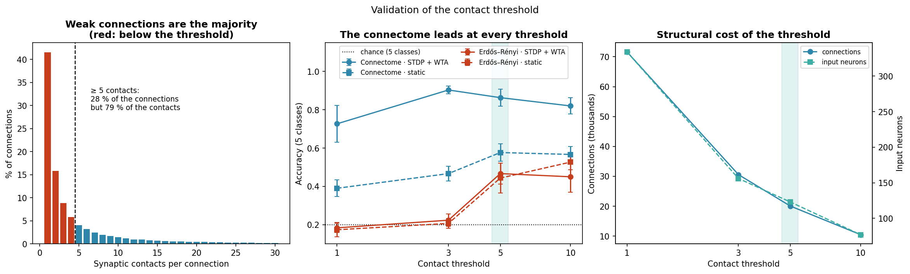

# Phase 04 results: modeling the song-interval task

Notebooks: [`01-audio-encoding.ipynb`](01-audio-encoding.ipynb), [`02-control-networks.ipynb`](02-control-networks.ipynb), [`03-connectome-static.ipynb`](03-connectome-static.ipynb), [`04-connectome-stdp.ipynb`](04-connectome-stdp.ipynb) · Scripts: [`run_experiments.py`](run_experiments.py), [`extra_seeds.py`](extra_seeds.py), [`control_stdp.py`](control_stdp.py), [`threshold_sweep.py`](threshold_sweep.py), [`plot_threshold_validation.py`](plot_threshold_validation.py), [`energy_frontier.py`](energy_frontier.py), [`baseline_ann.py`](baseline_ann.py) · Outputs: [`outputs/results.json`](outputs/results.json), [`outputs/extra_seeds.json`](outputs/extra_seeds.json), [`outputs/control_stdp.json`](outputs/control_stdp.json), [`outputs/threshold_sweep.json`](outputs/threshold_sweep.json), [`outputs/energy_frontier.json`](outputs/energy_frontier.json), [`outputs/baseline_ann.json`](outputs/baseline_ann.json)

---

## 1. Context and goal

Phase 02 extracted the auditory circuit of **Johnston's organ** (JO), the ear of the fruit fly, from the FlyWire **connectome**, the map of all the neurons of the fly brain and of the connections between them (Dorkenwald et al., 2024). The subgraph has 1,239 neurons, 20,059 connections (directed pairs of neurons) and 338,013 synaptic contacts. Only 123 of its JO neurons send connections onward, and they form the input layer. Phase 03 turned that graph into a **spiking neural network** (SNN), a network whose neurons communicate with brief electrical events called **spikes**, and calibrated it.

This phase runs the experiment. We organize the project by the phases of CRISP-DM (Chapman et al., 2000), and this is its modeling phase, which in the KDD process corresponds to data mining (Fayyad et al., 1996). The research question is whether a spiking network wired like the connectome and trained with a local learning rule beats networks with equivalent artificial wiring, in accuracy and in the number of spikes it needs. Our evaluation objective is to compare the spiking networks with one another in accuracy, learning speed, spike efficiency, selectivity and weight stability. This report covers accuracy and spike efficiency in depth; [phase 05](../05-evaluation/results.md) completes the evaluation.

A few terms recur throughout. The neurons are **leaky integrate-and-fire** (LIF) neurons with **three synaptic channels**. Each neuron adds up the current of an excitatory, an inhibitory and a modulatory channel, leaks it slowly and fires when its voltage crosses a threshold. The networks learn with **spike-timing-dependent plasticity** (STDP), a local rule that strengthens a connection when the sending neuron fires just before the receiving one and weakens it when it fires just after (Song et al., 2000). **Winner-take-all** (WTA) inhibition, a pool of inhibitory neurons, holds the network back when many neurons fire at once, so that a few of them specialize (Diehl & Cook, 2015; Masquelier et al., 2009). We compare three **topologies** (wirings). The connectome is the real one. An **Erdős–Rényi** graph places the same number of connections of each sign at random (Erdős & Rényi, 1959). A **configuration model** also keeps how many connections enter and leave each neuron, its degree (Molloy & Reed, 1995; Newman et al., 2001). Each topology runs without plasticity (static) and with STDP + WTA, and each of these six combinations is an experimental **arm**. A **seed** is the number that fixes the random generators, so that a run can be repeated exactly.

---

## 2. The task

**Telling apart the inter-pulse interval of the courtship song.** The *Drosophila melanogaster* male courts with a pulse song, a train of brief clicks made by vibrating one wing. The time between consecutive song pulses, the **inter-pulse interval** (IPI), is one of the main cues a female uses to recognize her species. It is about 34 ms in *D. melanogaster* and about 48 ms in the sister species *D. simulans* (Bennet-Clark & Ewing, 1969; Kyriacou & Hall, 1980), with reported ranges of 30–45 ms and 50–65 ms (Deutsch et al., 2019). Our 35 ms class is typical of *D. melanogaster*, and our 55 ms class falls in the range reported for *D. simulans*.

Our network covers only the first stage of the song pathway, the JO neurons and their direct partners. In the fly, selectivity for the species-specific interval appears further downstream, in central neurons such as pC1, pC2l and vpoEN (Baker et al., 2022; Zhou et al., 2015). Classifying the interval is therefore a **proxy task** that we impose on an early-stage circuit. It is not a function known to happen there.

There are five classes, with intervals of 25, 35, 45, 55 and 65 ms, so the **chance level** (the accuracy of guessing) is 0.200. All the songs share a 250 Hz carrier, a song-pulse width of 10 ms and the same expected number of input spikes. The carrier lies inside the 200–450 Hz range of fly pulse song (Clemens et al., 2018; Deutsch et al., 2019). **Only the rhythm tells them apart.**

The [audio-encoding notebook](01-audio-encoding.ipynb) turns each song into spikes, a step called **spike encoding**. A **gammatone filterbank** of 32 channels between 80 and 380 Hz splits the sound into frequency bands, using a widely used model of the human auditory filter (Patterson et al., 1992) with bandwidths on the ERB scale measured in human listeners (Glasberg & Moore, 1990). An **inner-hair-cell model** turns each band into a firing rate, through the envelope of the band and a saturating rate-level function like that of an auditory-nerve fiber (Sachs & Abbas, 1974). The name comes from the mammalian ear. The fly has no cochlea, so the model borrows the processing steps, not the anatomy. Each input neuron then fires at random with the rate of its channel.

### Why this task and not pure tones

An earlier version of the project asked the networks to classify six pure tones. When we measured how much information was already in the input layer, the 123 JO neurons alone classified the tones perfectly, in the same window used to compare the networks. With that ceiling the networks could only lose information. The comparison measured which network destroyed least, not which computed best, and the research hypothesis could not be tested.

The interval between pulses removes that ceiling. The **input-only ceiling** is the accuracy of the same readout applied to the input layer itself, with no network in between. For the song task it is **0.223**, against a chance level of 0.200, which leaves a headroom of 0.777 for the networks. The value 0.223 is the mean over the sixty runs of the experiment, and it counts the input spikes over the whole presentation, which if anything favors the input. Over the five seeds of the static arms it is 0.226, and the single measurement in Section 5 of the audio-encoding notebook, with twenty presentations per song, gives 0.250. All three say the same thing, that the input barely beats chance. We use **0.223** throughout because it rests on the largest sample.

Two songs with the same carrier have the same spectrum. The cosine between their per-channel profiles is **0.99996**, so the interval is not present in the rate code of the input. It can only be recovered through the dynamics of the network.

**The readout counts spikes in a window, with no temporal resolution.** The **linear readout** is a logistic regression (Pedregosa et al., 2011) that names the song from how many spikes each neuron fired, in the spirit of reservoir computing, where a recurrent network stays fixed and only a linear readout is trained (Maass et al., 2002). Counting is deliberate. A readout with temporal resolution would read the interval straight from the input and bring the ceiling back to where it started. Because it counts, the network has to **turn temporal structure into differences in firing rate**.

---

## 3. Experimental design

**A full factorial design**

$$\{\text{connectome},\ \text{Erdős–Rényi},\ \text{configuration model}\}
\times \{\text{static},\ \text{STDP+WTA}\}$$

We ran **15 seeds** in the three arms with plasticity and **5** in the three static arms, 60 runs in all. The plastic arms were extended from five to fifteen seeds because five were not enough to resolve the closest contrast, the connectome against the configuration model with plasticity. On the first five seeds that difference was +0.156, with p = 0.17, because the configuration model varied a great deal from seed to seed (standard deviation ± 0.215). That spread is not a fluke. The inhibition sweep of phase 03 already showed that, with the shared inhibition strength of 0.6 nA, the configuration model is **the most seed-sensitive topology** of the three. Its firing rate varies by 15.9 % across seeds, against 13.0 % for Erdős–Rényi and 4.8 % for the connectome ([phase 03 results](../03-data-preparation/results.md)).

The six arms share almost everything. Stimuli, neuron model, input layer, readout and parameters are the same, except the input gain. Phase 03 tuned it in each arm to reach the same **operating point**, a mean firing rate of 10 Hz before learning, with the song stimulus. Only the wiring changes, and whether the network learns. Learning brings STDP and the WTA layer together, and the static arms have neither.

Each song is presented 20 times for training and 20 times for testing, with disjoint seeds. The seeds of the random spike draw and of the timing jitter of the song pulses depend on the repetition, never on the class, so all five classes share each random realization.

The statistics are simple. Means are reported ± the standard deviation across seeds. A **paired comparison** sets two arms side by side seed by seed, so that only the factor under study changes. Paired t-tests use the seeds the two arms share, so a contrast between a static arm and a plastic one rests on five pairs. A one-way **ANOVA** (analysis of variance) tests whether the three topologies differ. The **p-value** is the probability of seeing a difference at least this large if there were none, and it is not corrected for multiple comparisons. The **effect size**, Cohen's d, expresses a difference in units of standard deviation (Cohen, 1988/2013). The values of d quoted here come from the [evaluation notebook of phase 05](../05-evaluation/01-comparative-evaluation.ipynb), which computes them with the population variance of each arm.

---

## 4. Main result

Integration window of 250 ms. Mean ± standard deviation over the seeds of each arm (15 with plasticity, 5 static).
**Chance = 0.200. Input-only ceiling = 0.223.**

| Topology | Plasticity | n | Accuracy | Rate (Hz) | Spikes per correct classification |
|---|---|---|---|---|---|
| **Connectome** | **STDP + WTA** | 15 | **0.875 ± 0.039** | 17.74 | 6,278 |
| Configuration model | STDP + WTA | 15 | 0.768 ± 0.148 | 21.54 | 9,209 |
| Configuration model | static | 5 | 0.604 ± 0.050 | 10.32 | **5,325** |
| Connectome | static | 5 | 0.566 ± 0.082 | 10.38 | 5,784 |
| Erdős–Rényi | static | 5 | 0.444 ± 0.057 | 12.74 | 9,235 |
| Erdős–Rényi | STDP + WTA | 15 | 0.443 ± 0.080 | 33.94 | 25,175 |

The **spikes per correct classification** are all the spikes the network fires during the test divided by the number of correct answers, a measure of what each answer costs. The effect of topology is significant in both conditions. The ANOVA gives F = 8.39, p = 0.005 for the static arms and **F = 76.38, p < 0.00001** with plasticity.

### Plasticity only pays off significantly on the biological topology

| Topology | Static | STDP + WTA | Δ | p |
|---|---|---|---|---|
| **Connectome** | 0.566 | **0.875** | **+0.309** | **0.0047** |
| Configuration model | 0.604 | 0.768 | +0.164 | 0.213 |
| Erdős–Rényi | 0.444 | 0.443 | −0.001 | 0.706 |

**This pattern, an interaction between topology and plasticity, is the central result of the project.** The networks have identical size, density and weight distribution, and they learn with the same rule and the same parameters. Yet the rule improves the biological wiring by **0.309**. On the control that keeps the degrees the gain is not significant, and on the random network there is none. Phase 05 tests the interaction directly. The gain of the connectome is larger than that of the random network (p = 0.0114) but not significantly larger than that of the degree-preserving control (p = 0.0988).

That +0.309 compares the fifteen plastic seeds with the five static ones. The strictly paired contrast, on the five seeds both arms share, gives +0.314 with the same p-value. We report +0.309 because it is the value the tables and notebooks use.

### The connectome against each control

With fifteen seeds, the connectome with plasticity **beats each of the other five arms with statistical significance**.

| Comparison | Δ accuracy | p | Cohen's d |
|---|---|---|---|
| vs Erdős–Rényi + STDP | **+0.433** | **< 0.00001** | 7.14 |
| vs Erdős–Rényi, static | **+0.431** | **0.00011** | 9.67 |
| vs connectome **without** STDP | **+0.309** | **0.0047** | 5.31 |
| vs configuration model, static | **+0.271** | **0.0016** | 6.56 |
| vs **configuration model + STDP** | **+0.107** | **0.0167** | 1.02 |

The last row is the decisive one. It is the strict control, the one that keeps, almost exactly, the degree sequence of the connectome, and a recent preprint argues that topology advantages reported for connectome-constrained networks can vanish against such controls (Dhiman, 2026). With five seeds the difference (+0.156) was not significant (p = 0.17). With fifteen it is (p = 0.0167), with an effect size of d = 1.02. Those ten seeds were added after the first result, and on them alone the connectome leads by +0.083, with p = 0.0593. **The advantage of the biological wiring is not explained by a few neurons that concentrate many connections.**

---

## 5. Accuracy against integration time

Five-class task, as in Section 4, so **chance is 0.200**. The **integration window** is the length of the response that the readout counts before deciding.

| Arm | 25 ms | 50 ms | 100 ms | **250 ms** | 500 ms |
|---|---|---|---|---|---|
| **Connectome + STDP** | 0.423 | 0.545 | 0.717 | **0.875** | 0.877 |
| Configuration model + STDP | 0.404 | 0.468 | 0.659 | 0.768 | 0.806 |
| Configuration model, static | 0.444 | 0.376 | 0.462 | 0.604 | 0.562 |
| Connectome, static | 0.414 | 0.388 | 0.430 | 0.566 | 0.554 |
| Erdős–Rényi, static | 0.444 | 0.330 | 0.370 | 0.444 | 0.504 |
| Erdős–Rényi + STDP | 0.328 | 0.306 | 0.374 | 0.443 | 0.534 |

Two curves grow steadily, the connectome and the degree-preserving control, both with plasticity. The connectome's is the only one that **levels off within the range**. It rises from 0.423 to 0.875 between 25 and 250 ms and gains nothing more with twice the time (0.877 at 500 ms). The degree-preserving control is still rising at the end of the range. A plausible mechanical reading is that a 250 ms window holds between about four song pulses (at 65 ms) and ten (at 25 ms), enough evidence to estimate a rhythm. The other four curves do not grow monotonically. At 25 ms every arm sits between 0.328 and 0.444, close to the others, and the order between arms there says little.

---

## 6. Difficulty gradient

Here the question changes. Instead of choosing among the five songs, the readout only has to tell **two** apart. It is an easier task, so **chance rises from 0.200 to 0.500**, and these numbers cannot be compared directly with those of Sections 4 and 5. Each pair comes from the same set of responses, by restricting the readout to two classes, with no new simulation.

What orders the pairs from left to right is the **relative difference**, not the difference in milliseconds. The last two pairs are both 10 ms apart. Ten milliseconds on a base of 35 is 29 % of the interval, and on a base of 45 only 22 %. This is Weber's law, by which what is registered of a change is its proportion (Gibbon, 1977). The series runs from 160 % down to 22 %.

| Arm | 25 vs 65 | 25 vs 55 | 35 vs 55 | 35 vs 45 | 45 vs 55 |
|---|---|---|---|---|---|
| **Connectome + STDP** | **1.000** | **0.997** | **0.998** | **0.983** | **0.955** |
| Configuration model + STDP | 0.990 | 0.995 | 0.983 | 0.950 | 0.927 |
| Configuration model, static | 0.980 | 0.995 | 0.970 | 0.900 | 0.785 |
| Connectome, static | 0.970 | 0.920 | 0.900 | 0.810 | 0.750 |
| Erdős–Rényi + STDP | 0.933 | 0.905 | 0.848 | 0.672 | 0.682 |
| Erdős–Rényi, static | 0.920 | 0.910 | 0.845 | 0.630 | 0.650 |

Chance = 0.500. Static arms: 5 seeds; arms with STDP: 15.

In four of the six arms the pair 45 vs 55 ms comes out worse than 35 vs 45 ms, as the relative difference predicts. The two Erdős–Rényi arms are the exception. Their accuracies on the two hard pairs are close to each other and not far above chance, and the hardest pair comes out slightly better.

The connectome with plasticity tells **35 from 55 ms apart with an accuracy of 0.998**. That pair sets a song typical of *D. melanogaster* against one in the range of *D. simulans*. On the hardest pair (45 vs 55 ms, 10 ms apart) it keeps 0.955, where the random network with plasticity stays at 0.682.

Each number should be read against its own chance line. The static connectome scores 0.750 on the hardest pair against a chance of 0.500, and 0.566 on the five-class task against a chance of 0.200. The two values answer different questions and are not compared.

---

## 7. Spike efficiency

| Arm | Spikes per correct classification |
|---|---|
| Configuration model, static | **5,325** |
| Connectome, static | 5,784 |
| **Connectome + STDP** | **6,278** |
| Configuration model + STDP | 9,209 |
| Erdős–Rényi, static | 9,235 |
| Erdős–Rényi + STDP | 25,175 |

The connectome with plasticity reaches 0.875 with 6,278 spikes per correct answer. The random network with the same plasticity spends **4.0 times more** to reach 0.443, about half the accuracy. Against the configuration model with plasticity, the connectome is more accurate (0.875 against 0.768) and spends 31.8 % fewer spikes.

Among the static arms the connectome is competitive but not the cheapest (5,784 against 5,325). The efficiency advantage appears when plasticity comes in.

These are spike counts. On event-driven neuromorphic chips such as Loihi, energy is spent only when spikes occur (Schuman et al., 2022), so spikes per correct answer are a natural proxy for the activity a network needs. They are not an energy comparison with conventional networks, which Section 11 makes and which comes out against the spiking networks.

---

## 8. The channel-to-neuron mapping

The 32 channels of the filterbank have to be assigned to the 123 input neurons. JO-A and JO-B are the vibration-sensitive subgroups of Johnston's organ. JO-B prefers low-frequency vibration, below about 100 Hz, and JO-A carries the high-frequency responses (Kamikouchi et al., 2009; Matsuo et al., 2014). The default mapping uses this as a coarse, two-level anchor, with JO-B neurons on the low channels and JO-A neurons on the high ones. We compared it with three alternatives.

| Mapping | Static | STDP + WTA |
|---|---|---|
| Anchored (JO-B low, JO-A high) | 0.566 ± 0.082 | 0.880 ± 0.048 † |
| Anchored, inverted | 0.758 ± 0.044 | 0.900 ± 0.040 |
| `root_id` order | 0.676 ± 0.044 | 0.892 ± 0.016 |
| Random assignment | 0.736 ± 0.045 | 0.920 ± 0.029 |

Five seeds per cell. † The anchored arm with plasticity is the main connectome arm on its first five seeds, which the code reproduces exactly, so it gives 0.880 here against 0.875 over fifteen seeds.

**In this task tonotopic anchoring does not help, and that was expected.** The five songs share the carrier, so there is no frequency axis to exploit. Every mapping gives each channel a block of three or four input neurons, so the same number of input neurons responds to the song. What the mapping decides is which neurons they are, and so which partners downstream receive the song. A plausible reading is that the anchored mapping sends the song to neighbors that share many targets, while a random assignment spreads it over neurons with different targets. Without plasticity the anchored mapping is clearly the worst, 0.170 below the random one (p = 0.0327) and 0.192 below its inverse (p = 0.0151), both paired by seed.

Two consequences follow.

1. **The main results use the anchored mapping, the least favorable one for the accuracy of the connectome.** With any other its accuracy would be as high or higher. The control networks, however, ran only with the anchored mapping, so we do not know how they would do with the others.
2. **The accuracy of the connectome does not depend on the mapping, but its gain from plasticity does.** With all four, the connectome with plasticity stays between 0.880 and 0.920, far above the input-only ceiling (0.223) and above every arm of the random network. Its gain from plasticity is +0.314 on these five seeds with the anchored mapping and between +0.142 and +0.216 with the others, because the static connectome does worst with the anchored one.

---

## 9. Plasticity: how much the weights move

| Arm | Mean \|Δw\| | Final drift |
|---|---|---|
| Connectome + STDP | 0.543 | **0.0124** |
| Erdős–Rényi + STDP | 0.602 | 0.0252 |
| Configuration model + STDP | **0.858** | 0.0146 |

Fifteen seeds per arm. The **mean absolute weight change** |Δw| says how far learning moved the weights, and the **drift** of the mean weight over the last 20 % of training says whether they were still moving at the end.

All three networks undergo a substantial amount of synaptic change, but only in the connectome does that change bring a significant gain in accuracy. The connectome moves its weights the least and ends with the smallest drift. It does not learn more. **It learns better.** The structure of the wiring decides whether plasticity finds a useful solution or only redistributes weights.

### Control of the learning rule

Could the result depend on the settings of the rule rather than on the wiring? [`control_stdp.py`](control_stdp.py) runs four variants of the connectome with STDP + WTA, with three seeds each. Two weight ceilings are crossed with two learning rates. The weight ceiling is the largest value a weight may reach during learning. The two tested are the largest initial weight, which the experiment uses, and the earlier four times the mean excitatory weight. The learning rates are the standard one and one five times smaller. The standard deviations here use the population formula.

| Variant | Accuracy | Rate (Hz) | Mean \|Δw\| |
|---|---|---|---|
| **High weight ceiling (the configuration used)** | **0.863 ± 0.045** | 18.43 | 0.5892 |
| Weight ceiling of 4 × the mean | 0.787 ± 0.084 | 12.76 | 0.2431 |
| Learning rate ÷ 5 | 0.830 ± 0.016 | 16.39 | 0.4262 |
| Learning rate ÷ 5 and weight ceiling of 4 × the mean | 0.787 ± 0.042 | 12.00 | 0.1877 |

The rule we use is the best of the four. A lower weight ceiling or a slower learning rate makes the weights move less and the network fire less, and in every case accuracy drops. The configuration used reproduces exactly the first three seeds of the main connectome arm (0.863 ± 0.045). All four variants stay well above the static connectome (0.566 ± 0.082 at 10.38 Hz). In the earlier tone task, none of these variants made plasticity useful. With the song task, the standard configuration already gives +0.309 over the static connectome. The problem was the task, not the rule.

---

## 10. Robustness to the contact threshold

The subgraph keeps only the connections formed by at least 5 synaptic contacts. Dorkenwald et al. (2024) use that threshold, and Codex applies it by default, to discard false positives of automatic synapse detection. They call it reasonable but arbitrary. In this circuit it has a high cost, because it removes 31.6 % of the 393 annotated JO neurons. We therefore checked that it does not condition the result. [`threshold_sweep.py`](threshold_sweep.py) rebuilt the subgraph with thresholds of 1, 3, 5 and 10 contacts, **recalibrated the operating point at each one** and ran the whole task, with three seeds per arm.

| Threshold | Neurons | Connections | Input | Connectome + STDP | Connectome, static | ER + STDP | ER, static | Advantage |
|---|---|---|---|---|---|---|---|---|
| ≥ 1 | 1,361 | 71,621 | 334 | 0.727 | 0.390 | 0.183 † | 0.173 † | +0.543 † |
| ≥ 3 | 1,310 | 30,569 | 156 | 0.903 | 0.467 | 0.223 | 0.207 | **+0.680** |
| **≥ 5** | **1,239** | **20,059** | **123** | **0.863** | **0.577** | **0.467** | **0.443** | **+0.397** |
| ≥ 10 | 1,075 | 10,475 | 77 | 0.820 | 0.567 | 0.450 | 0.527 | +0.370 |

ER = Erdős–Rényi. Five-class accuracy (chance = 0.200), three seeds per arm. The "Advantage" column is the connectome with STDP minus Erdős–Rényi with STDP. All the values come from one run of the sweep, `outputs/threshold_sweep.json`.

† At threshold 1 the random network **could not be calibrated**. With 71,621 connections it stays far above the 10 Hz target even with the minimum input gain (0.4755 nA), at 37.39 Hz without plasticity, so those cells are not at the common operating point and their advantage is not comparable with the others.

**Why the ≥ 5 row does not repeat the 0.875 of the main result.** The sweep runs three seeds. On those same three seeds the main experiment also gives 0.863 ± 0.045 (population standard deviation), because the recalibration at threshold 5 lands on the same input gain. The 0.875 of Section 4 is the mean over fifteen seeds. The two agree within their spread.

Three conclusions follow.

1. **Without a threshold, performance drops.** The connectome with plasticity falls from 0.863 to 0.727, even though it has 2.7 times more input neurons. The single-contact connections seem to add detection noise rather than useful connectivity. The random network cannot even be brought to the operating point.
2. **At threshold 3 the advantage of the connectome looks larger, but mostly for the wrong reason.** It grows from +0.397 to +0.680 chiefly because **the control gets worse**. Erdős–Rényi with STDP falls from 0.467 to 0.223, while the connectome rises only from 0.863 to 0.903. Adopting threshold 3 would inflate the effect by handicapping the control, which is exactly what a threshold chosen after seeing the result would do.
3. **The advantage holds at every threshold that can be calibrated**, with +0.680 at ≥ 3, +0.397 at ≥ 5 and +0.370 at ≥ 10. The sweep compares the connectome only with Erdős–Rényi, with three seeds per arm and no statistical test.

We keep **≥ 5**. It was fixed before any result was known, it is the value Dorkenwald et al. (2024) use, and the sweep shows that the conclusion holds across the usable range.

The figure, drawn by [`plot_threshold_validation.py`](plot_threshold_validation.py), puts the choice in context. The left panel is the distribution of connections by number of contacts. Connections with exactly one contact are 41.5 % of all connections but carry only 7.0 % of the contacts. Those with 5 or more contacts are 28.0 % of the connections and carry 79.3 % of the contacts. The central panel is the accuracy of the four arms at each threshold, and the right panel the structural cost of the threshold in connections and input neurons.

---

## 11. Comparison with conventional networks

The case for spiking networks rests largely on energy. On neuromorphic hardware they promise to compute with far less energy than conventional systems, because event-driven chips spend energy only when spikes occur (Roy et al., 2019; Schuman et al., 2022). That promise is motivation taken from the literature, not a result of this work. We checked whether it holds on this particular task, because otherwise it should not be claimed.

The comparison is with **conventional, or second-generation, artificial neural networks** (ANNs), networks whose units output continuous values rather than spikes (Maass, 1997). Their basic operation is the **multiply-accumulate** (MAC).

### Method

We built the **energy-accuracy frontier** of both families on the same input spike trains. For each level of accuracy we searched for the **cheapest** model that reaches it, instead of comparing against one arbitrary model.

- **ANNs.** We tried a linear classifier and a multilayer perceptron (scikit-learn; Pedregosa et al., 2011) on 5, 10, 25 or 50 time windows of the input spike counts. We also tried a streaming GRU, a recurrent network that processes the input step by step (Cho et al., 2014), trained with Adam (Kingma & Ba, 2015) in PyTorch (Ansel et al., 2024). Hidden sizes run from 8 to 128 (8 to 64 for the GRU), and each model was trained once. We cost each MAC at 1.5 pJ, a 16-bit floating-point multiply (1.1 pJ) plus add (0.4 pJ) at 45 nm, and each addition at 0.1 pJ, a 32-bit integer add (Horowitz, 2014). Building the features takes one addition per input spike. An 8-bit integer MAC would cost about 0.23 pJ, which would only widen the gap in favor of the conventional network.
- **SNN.** For the connectome with and without STDP and for Erdős–Rényi with STDP, we swept the input gain (0.15, 0.25, 0.40, 0.60 and 1.00 times the calibrated value) and the integration window, with three seeds. The cost is the estimated number of synaptic events per inference, the spikes of the network times the mean out-degree of its neurons. Each event costs 23.6 pJ, the minimum energy per synaptic spike operation reported for Loihi at 0.75 V from pre-silicon simulation (Davies et al., 2018).

### Result

| Accuracy required | Cheapest ANN | Cheapest SNN | Ratio |
|---|---|---|---|
| ≥ 0.45 | linear, 5 windows: **0.0049 µJ** | static connectome, 25 ms: 0.042 µJ | 9× |
| ≥ 0.60 | linear, 5 windows: **0.0049 µJ** | connectome + STDP, 100 ms: 0.524 µJ | 108× |
| ≥ 0.75 | linear, 10 windows: **0.0095 µJ** | connectome + STDP, 250 ms: 1.627 µJ | 172× |
| ≥ 0.88 | linear, 10 windows: **0.0095 µJ** | connectome + STDP, 500 ms: 4.363 µJ | **461×** |
| ≥ 0.95 | linear, 10 windows: **0.0095 µJ** | not reachable | — |

The linear classifier on 10 windows reaches 0.960, so it is also the cheapest ANN that meets the 0.95 criterion. No setting of the SNN goes above 0.880.

**A linear classifier on 10 time windows reaches an accuracy of 0.960 with 6,150 MAC, that is, 0.0095 µJ.** The SNN needs 184,859 synaptic events, 4.363 µJ, to reach 0.880. The gap is **461×**, and none of the settings we swept closes it. The linear classifier sees when the input spikes occur, and the interval between song pulses is a matter of timing. That is why it can score far above the input-only ceiling of 0.223, which belongs to a readout that only counts spikes.

> To break even, a synaptic event would have to cost about 0.051 pJ, 0.034 times a MAC. Taken at face value, Loihi's 23.6 pJ per synaptic operation is about 5 to 100 times the arithmetic cost of a 45 nm MAC (0.23 to 4.6 pJ; Horowitz, 2014). The comparison is only indicative, because the Loihi figure includes memory access and comes from a different process. Studies that compare both kinds of network on the same hardware also find that spiking networks win only at very low activity (Dampfhoffer et al., 2023; Davidson & Furber, 2021), although an analytical study reports spiking networks 6 to 8 times more efficient than their conventional counterparts in its own setting (Lemaire et al., 2023).

**On this task the spiking network is not more energy-efficient than a conventional network, and we do not claim that it is.** The spiking networks are not cheaper than a linear classifier here.

### Why, and what would change it

The cause is neither the topology nor plasticity. It is the **scale of the problem**. A subgraph of 1,239 neurons and 20,059 connections is oversized for a five-class task that a linear model solves with 6,150 operations. Even a maximally sparse version of this network, with a single spike per neuron, would cost about 20,000 synaptic events, more than three times the operations of the ANN.

Reported energy advantages of spiking networks depend mainly on very sparse activity (Dampfhoffer et al., 2023; Davidson & Furber, 2021), and on Loihi they have been reported to grow with network size (Blouw et al., 2019). This work is not in that regime.

### The one energy advantage we estimated

If **silence produces no input spikes, the network fires no spike at all** and its cost is zero. That is an assumption, not a simulation. The encoder of this model keeps a spontaneous rate of 5 Hz on every channel, which this estimate ignores. A conventional network, on the other hand, runs its full inference in every window, whether there is sound or not. In an always-on setting the average cost depends on the **duty cycle**, the fraction of time in which there is a signal to process.

| Duty cycle | SNN 0.880 | SNN 0.630 | SNN 0.483 | ANN 0.960 |
|---|---|---|---|---|
| 100 % | 4.363 µJ | 0.524 µJ | 0.073 µJ | 0.0095 µJ |
| 10 % | 0.436 µJ | 0.052 µJ | 0.0073 µJ | 0.0095 µJ |
| 1 % | 0.044 µJ | 0.0052 µJ | 0.0007 µJ | 0.0095 µJ |

The column headings give the accuracy of each configuration. The SNN becomes cheaper below a duty cycle of **0.22 %** in its most accurate configuration, **1.81 %** in the intermediate one and **13.06 %** in its sparsest regime, where its accuracy is only 0.483.

It is a narrow and idealized advantage. It applies to always-on detection with very sporadic activity, not to continuous classification, and it shrinks if the conventional network is switched off when there is no signal.

### What still holds

None of this affects the objectives of the project. Our evaluation compares **the spiking networks with one another**, and on spike efficiency the result is clear and favorable.

| | Spikes per correct classification |
|---|---|
| Connectome + STDP | **6,278** |
| Erdős–Rényi + STDP | 25,175 |

**4.0 times fewer spikes for twice the accuracy.** The comparison with conventional networks lies outside the declared scope of the project. We report it here only to mark how far the conclusions reach. The energy advantage of spiking networks remains a motivation from the literature, not a finding of this work.

Data in [`outputs/baseline_ann.json`](outputs/baseline_ann.json) and [`outputs/energy_frontier.json`](outputs/energy_frontier.json); scripts [`baseline_ann.py`](baseline_ann.py) and [`energy_frontier.py`](energy_frontier.py).

---

## 12. Conclusions

**On the central research question**, whether an SNN wired like the connectome and trained with STDP beats an equivalent artificial SNN in accuracy and spike efficiency:

1. **Yes, on the proxy task we impose on this circuit.** The connectome with plasticity reaches 0.875 ± 0.039 and **beats each of the other five arms with statistical significance**, including the control that keeps, almost exactly, its degree sequence (+0.107, p = 0.0167), against an input-only ceiling of 0.223 and a chance level of 0.200.
2. **Plasticity only pays off significantly on the biological topology.** It improves the connectome by 0.309 (p = 0.0047), the degree-preserving control by a non-significant 0.164, and the random network not at all. This interaction between structure and learning is the most specific finding of the project, with one caveat. Tested directly, it is significant against the random network but not against the degree-preserving control. The same rule, on networks of identical scale and density, only pays off significantly when the wiring is right.
3. **Among spiking networks, there is also an efficiency advantage.** The connectome with plasticity needs 6,278 spikes per correct answer, against 25,175 for the random network with plasticity, **4.0 times fewer** for twice the accuracy.
4. **Without plasticity the advantage is small.** The static connectome beats the random network (+0.122, p = 0.0421) but stays slightly behind the degree-preserving control, without a significant difference (−0.038, p = 0.3897). Wiring alone contributes little. What it contributes is **being the right substrate for plasticity to work on**.
5. **The discrimination between species is almost perfect.** The pair 35 vs 55 ms, a song typical of *D. melanogaster* against one in the range of *D. simulans*, is classified with an accuracy of **0.998** against a chance level of 0.500.
6. **The earlier result is explained, not contradicted.** With pure tones there was no advantage because there was no headroom. The input solved the task by itself and the networks could only degrade it. What changed was not the model or its parameters but the question.
7. **The result does not depend on the contact threshold.** We rebuilt the subgraph at thresholds of 1, 3, 5 and 10 and recalibrated at each one. The advantage of the connectome over the random network with plasticity holds at the three thresholds that can be calibrated (+0.680 at ≥ 3, +0.397 at ≥ 5, +0.370 at ≥ 10). At threshold 3 the connectome scores a little higher (0.903 against 0.863, three seeds, with no paired test), and removing the threshold makes it worse.
8. **There is no energy advantage over conventional networks on this task.** A linear classifier reaches higher accuracy for about 461 times less energy. The energy argument for spiking networks stays a motivation from the literature.

### A methodological lesson

**Before comparing architectures, measure how much information is already in the input.** That check, now reported in every experiment, is what separates "this architecture adds nothing" from "this task leaves no room for any architecture to add anything". Without it, this project would have concluded that the biological wiring is useless, when the real problem was that it was being asked the wrong question.

---

## Limitations

- **The task is a proxy.** In the fly, selectivity for the inter-pulse interval appears downstream of the circuit we model (Section 2). We impose the task on an early-stage circuit to compare wirings, not to model its biological function.
- **The operating point is matched before learning, not after.** The arms with plasticity end between 17.74 and 33.94 Hz, against 10.32 to 12.74 Hz for the static ones, so comparisons of accuracy across plasticity conditions should be read together with the spikes per correct classification. The 10 Hz target itself is a reasoned choice that we did not sweep ([phase 03 results](../03-data-preparation/results.md)).
- **The advantage over the degree-preserving control is the narrowest** (+0.107, p = 0.0167, d = 1.02). It is significant with fifteen seeds, but it should be reported with its effect size and not with the p-value alone. Part of that narrowness is the variance of the control itself, which is the most seed-sensitive arm already in the inhibition sweep of phase 03, not only in the task.
- **The p-values are not corrected for multiple comparisons.** Over the five contrasts of the connectome with plasticity, the Holm procedure keeps all of them below 0.05. The stricter Bonferroni correction raises the decisive one to 0.0836 (phase 05).
- **The interaction is significant against one control only.** Tested directly, the gain of the connectome is larger than that of the random network (p = 0.0114) but not significantly larger than that of the degree-preserving control (p = 0.0988).
- **Seeds added after a first result.** The plastic arms went from five to fifteen seeds after a non-significant first contrast with the degree-preserving control. On the ten added seeds alone the connectome leads by +0.083, with p = 0.0593.
- **Plasticity comes with the WTA layer.** The arms with plasticity add STDP and the winner-take-all inhibition at once, and no static arm has that inhibition. The gain we attribute to plasticity is that of the two together.
- **Spike counts leave out the WTA pool.** They cover the 1,239 neurons of the circuit, not the 50 interneurons of the plastic arms.
- **The robustness checks cover part of the comparison.** The channel mappings were run only on the connectome, and the threshold sweep compares it only with the random network.
- **The readout is linear.** A non-linear decoder could extract structure that logistic regression misses, and not necessarily to the same degree in every topology.
- **Five intervals, one carrier, synthetic songs.** The result should be checked with other carriers and with recorded natural songs.
- **No synaptic delays.** All transmission is instantaneous. In a temporal task, delays proportional to anatomical distance would give the spatial structure of the connectome an extra dynamic consequence, and could widen the advantage observed.
- **Both ears form one input layer.** The JO neurons of the two hemispheres receive the same sound, and we do not model differences between the two antennae.
- **One realization of each control topology per seed.** The seeds vary the wiring of the control, the initial conditions and the random spike draws all at once.
- **The learning rate is our own choice.** It is ten times that of Song et al. (2000), chosen for the short training used here. The control of the rule (Section 9) shows that slower learning does not do better.
- **The energy estimates are indicative.** They multiply operation counts by published costs from different technologies (Section 11), and the synaptic events of the SNN are estimated from the mean out-degree, not counted connection by connection. The cost of the readout of the SNN is left out, which favors it, and each conventional network was trained once.

---

## References

- Ansel, J., Yang, E., He, H., Gimelshein, N., Jain, A., Voznesensky, M., Bao, B., Bell, P., Berard, D., Burovski, E., Chauhan, G., Chourdia, A., Constable, W., Desmaison, A., DeVito, Z., Ellison, E., Feng, W., Gong, J., Gschwind, M., . . . Chintala, S. (2024). PyTorch 2: Faster machine learning through dynamic Python bytecode transformation and graph compilation. In *Proceedings of the 29th ACM International Conference on Architectural Support for Programming Languages and Operating Systems, Volume 2* (pp. 929–947). ACM. https://doi.org/10.1145/3620665.3640366
- Baker, C. A., McKellar, C., Pang, R., Nern, A., Dorkenwald, S., Pacheco, D. A., Eckstein, N., Funke, J., Dickson, B. J., & Murthy, M. (2022). Neural network organization for courtship-song feature detection in *Drosophila*. *Current Biology, 32*(15), 3317–3333.e7. https://doi.org/10.1016/j.cub.2022.06.019
- Bennet-Clark, H. C., & Ewing, A. W. (1969). Pulse interval as a critical parameter in the courtship song of *Drosophila melanogaster*. *Animal Behaviour, 17*(4), 755–759. https://doi.org/10.1016/S0003-3472(69)80023-0
- Blouw, P., Choo, X., Hunsberger, E., & Eliasmith, C. (2019). Benchmarking keyword spotting efficiency on neuromorphic hardware. In *Proceedings of the 7th Annual Neuro-inspired Computational Elements Workshop (NICE ’19)* (pp. 1–8). ACM. https://doi.org/10.1145/3320288.3320304
- Chapman, P., Clinton, J., Kerber, R., Khabaza, T., Reinartz, T., Shearer, C., & Wirth, R. (2000). *CRISP-DM 1.0: Step-by-step data mining guide*. SPSS Inc. https://web.archive.org/web/20060207174803/http://www.crisp-dm.org/CRISPWP-0800.pdf
- Cho, K., van Merrienboer, B., Gulcehre, C., Bahdanau, D., Bougares, F., Schwenk, H., & Bengio, Y. (2014). Learning phrase representations using RNN encoder–decoder for statistical machine translation. In *Proceedings of the 2014 Conference on Empirical Methods in Natural Language Processing (EMNLP)* (pp. 1724–1734). Association for Computational Linguistics. https://doi.org/10.3115/v1/D14-1179
- Clemens, J., Coen, P., Roemschied, F. A., Pereira, T. D., Mazumder, D., Aldarondo, D. E., Pacheco, D. A., & Murthy, M. (2018). Discovery of a new song mode in *Drosophila* reveals hidden structure in the sensory and neural drivers of behavior. *Current Biology, 28*(15), 2400–2412.e6. https://doi.org/10.1016/j.cub.2018.06.011
- Cohen, J. (2013). *Statistical power analysis for the behavioral sciences* (2nd ed.). Routledge. https://doi.org/10.4324/9780203771587 (Original work published 1988)
- Dampfhoffer, M., Mesquida, T., Valentian, A., & Anghel, L. (2023). Are SNNs really more energy-efficient than ANNs? An in-depth hardware-aware study. *IEEE Transactions on Emerging Topics in Computational Intelligence, 7*(3), 731–741. https://doi.org/10.1109/TETCI.2022.3214509
- Davidson, S., & Furber, S. B. (2021). Comparison of artificial and spiking neural networks on digital hardware. *Frontiers in Neuroscience, 15*, Article 651141. https://doi.org/10.3389/fnins.2021.651141
- Davies, M., Srinivasa, N., Lin, T.-H., Chinya, G., Cao, Y., Choday, S. H., Dimou, G., Joshi, P., Imam, N., Jain, S., Liao, Y., Lin, C.-K., Lines, A., Liu, R., Mathaikutty, D., McCoy, S., Paul, A., Tse, J., Venkataramanan, G., . . . Wang, H. (2018). Loihi: A neuromorphic manycore processor with on-chip learning. *IEEE Micro, 38*(1), 82–99. https://doi.org/10.1109/MM.2018.112130359
- Deutsch, D., Clemens, J., Thiberge, S. Y., Guan, G., & Murthy, M. (2019). Shared song detector neurons in *Drosophila* male and female brains drive sex-specific behaviors. *Current Biology, 29*(19), 3200–3215.e5. https://doi.org/10.1016/j.cub.2019.08.008
- Dhiman, N. (2026). *Topological sensitivity in connectome-constrained neural networks* (arXiv:2604.04033) [Preprint]. arXiv. https://doi.org/10.48550/arXiv.2604.04033
- Diehl, P. U., & Cook, M. (2015). Unsupervised learning of digit recognition using spike-timing-dependent plasticity. *Frontiers in Computational Neuroscience, 9*, Article 99. https://doi.org/10.3389/fncom.2015.00099
- Dorkenwald, S., Matsliah, A., Sterling, A. R., Schlegel, P., Yu, S.-c., McKellar, C. E., Lin, A., Costa, M., Eichler, K., Yin, Y., Silversmith, W., Schneider-Mizell, C., Jordan, C. S., Brittain, D., Halageri, A., Kuehner, K., Ogedengbe, O., Morey, R., Gager, J., . . . The FlyWire Consortium. (2024). Neuronal wiring diagram of an adult brain. *Nature, 634*(8032), 124–138. https://doi.org/10.1038/s41586-024-07558-y
- Erdős, P., & Rényi, A. (1959). On random graphs I. *Publicationes Mathematicae Debrecen, 6*(3–4), 290–297. https://doi.org/10.5486/PMD.1959.6.3-4.12
- Fayyad, U., Piatetsky-Shapiro, G., & Smyth, P. (1996). From data mining to knowledge discovery in databases. *AI Magazine, 17*(3), 37–54. https://doi.org/10.1609/aimag.v17i3.1230
- Gibbon, J. (1977). Scalar expectancy theory and Weber’s law in animal timing. *Psychological Review, 84*(3), 279–325. https://doi.org/10.1037/0033-295X.84.3.279
- Glasberg, B. R., & Moore, B. C. J. (1990). Derivation of auditory filter shapes from notched-noise data. *Hearing Research, 47*(1–2), 103–138. https://doi.org/10.1016/0378-5955(90)90170-T
- Horowitz, M. (2014). 1.1 Computing’s energy problem (and what we can do about it). In *2014 IEEE International Solid-State Circuits Conference Digest of Technical Papers (ISSCC)* (pp. 10–14). IEEE. https://doi.org/10.1109/ISSCC.2014.6757323
- Kamikouchi, A., Inagaki, H. K., Effertz, T., Hendrich, O., Fiala, A., Göpfert, M. C., & Ito, K. (2009). The neural basis of *Drosophila* gravity-sensing and hearing. *Nature, 458*(7235), 165–171. https://doi.org/10.1038/nature07810
- Kingma, D. P., & Ba, J. (2015). Adam: A method for stochastic optimization. In *3rd International Conference on Learning Representations (ICLR 2015)*. https://arxiv.org/abs/1412.6980
- Kyriacou, C. P., & Hall, J. C. (1980). Circadian rhythm mutations in *Drosophila melanogaster* affect short-term fluctuations in the male’s courtship song. *Proceedings of the National Academy of Sciences, 77*(11), 6729–6733. https://doi.org/10.1073/pnas.77.11.6729
- Lemaire, E., Cordone, L., Castagnetti, A., Novac, P.-E., Courtois, J., & Miramond, B. (2023). An analytical estimation of spiking neural networks energy efficiency. In *Neural information processing (ICONIP 2022)* (pp. 574–587). Springer. https://doi.org/10.1007/978-3-031-30105-6_48
- Maass, W. (1997). Networks of spiking neurons: The third generation of neural network models. *Neural Networks, 10*(9), 1659–1671. https://doi.org/10.1016/S0893-6080(97)00011-7
- Maass, W., Natschläger, T., & Markram, H. (2002). Real-time computing without stable states: A new framework for neural computation based on perturbations. *Neural Computation, 14*(11), 2531–2560. https://doi.org/10.1162/089976602760407955
- Masquelier, T., Guyonneau, R., & Thorpe, S. J. (2009). Competitive STDP-based spike pattern learning. *Neural Computation, 21*(5), 1259–1276. https://doi.org/10.1162/neco.2008.06-08-804
- Matsuo, E., Yamada, D., Ishikawa, Y., Asai, T., Ishimoto, H., & Kamikouchi, A. (2014). Identification of novel vibration- and deflection-sensitive neuronal subgroups in Johnston’s organ of the fruit fly. *Frontiers in Physiology, 5*, Article 179. https://doi.org/10.3389/fphys.2014.00179
- Molloy, M., & Reed, B. (1995). A critical point for random graphs with a given degree sequence. *Random Structures & Algorithms, 6*(2–3), 161–180. https://doi.org/10.1002/rsa.3240060204
- Newman, M. E. J., Strogatz, S. H., & Watts, D. J. (2001). Random graphs with arbitrary degree distributions and their applications. *Physical Review E, 64*(2), Article 026118. https://doi.org/10.1103/PhysRevE.64.026118
- Patterson, R. D., Robinson, K., Holdsworth, J., McKeown, D., Zhang, C., & Allerhand, M. (1992). Complex sounds and auditory images. In Y. Cazals, L. Demany, & K. Horner (Eds.), *Auditory physiology and perception* (pp. 429–446). Pergamon. https://doi.org/10.1016/B978-0-08-041847-6.50054-X
- Pedregosa, F., Varoquaux, G., Gramfort, A., Michel, V., Thirion, B., Grisel, O., Blondel, M., Prettenhofer, P., Weiss, R., Dubourg, V., Vanderplas, J., Passos, A., Cournapeau, D., Brucher, M., Perrot, M., & Duchesnay, É. (2011). Scikit-learn: Machine learning in Python. *Journal of Machine Learning Research, 12*, 2825–2830. https://jmlr.org/papers/v12/pedregosa11a.html
- Roy, K., Jaiswal, A., & Panda, P. (2019). Towards spike-based machine intelligence with neuromorphic computing. *Nature, 575*(7784), 607–617. https://doi.org/10.1038/s41586-019-1677-2
- Sachs, M. B., & Abbas, P. J. (1974). Rate versus level functions for auditory-nerve fibers in cats: Tone-burst stimuli. *The Journal of the Acoustical Society of America, 56*(6), 1835–1847. https://doi.org/10.1121/1.1903521
- Schuman, C. D., Kulkarni, S. R., Parsa, M., Mitchell, J. P., Date, P., & Kay, B. (2022). Opportunities for neuromorphic computing algorithms and applications. *Nature Computational Science, 2*(1), 10–19. https://doi.org/10.1038/s43588-021-00184-y
- Song, S., Miller, K. D., & Abbott, L. F. (2000). Competitive Hebbian learning through spike-timing-dependent synaptic plasticity. *Nature Neuroscience, 3*(9), 919–926. https://doi.org/10.1038/78829
- Zhou, C., Franconville, R., Vaughan, A. G., Robinett, C. C., Jayaraman, V., & Baker, B. S. (2015). Central neural circuitry mediating courtship song perception in male *Drosophila*. *eLife, 4*, Article e08477. https://doi.org/10.7554/eLife.08477
