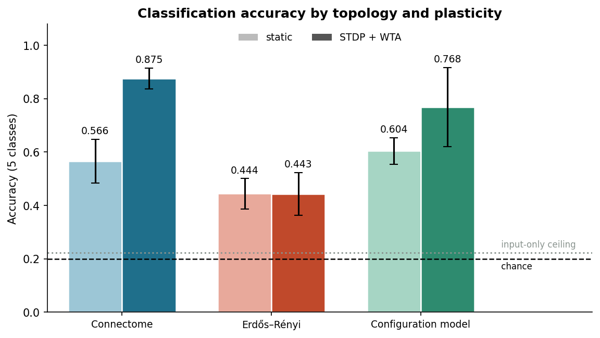
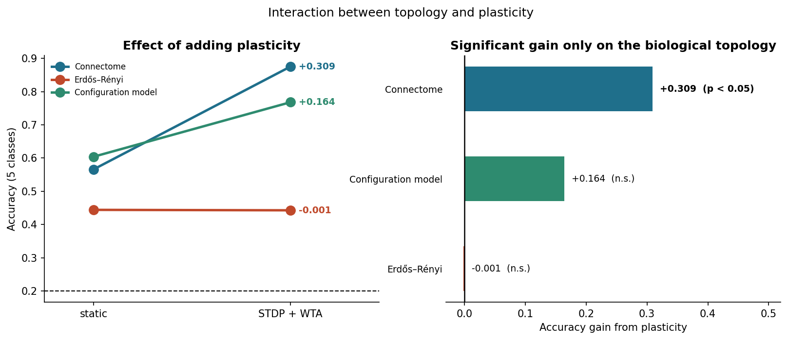
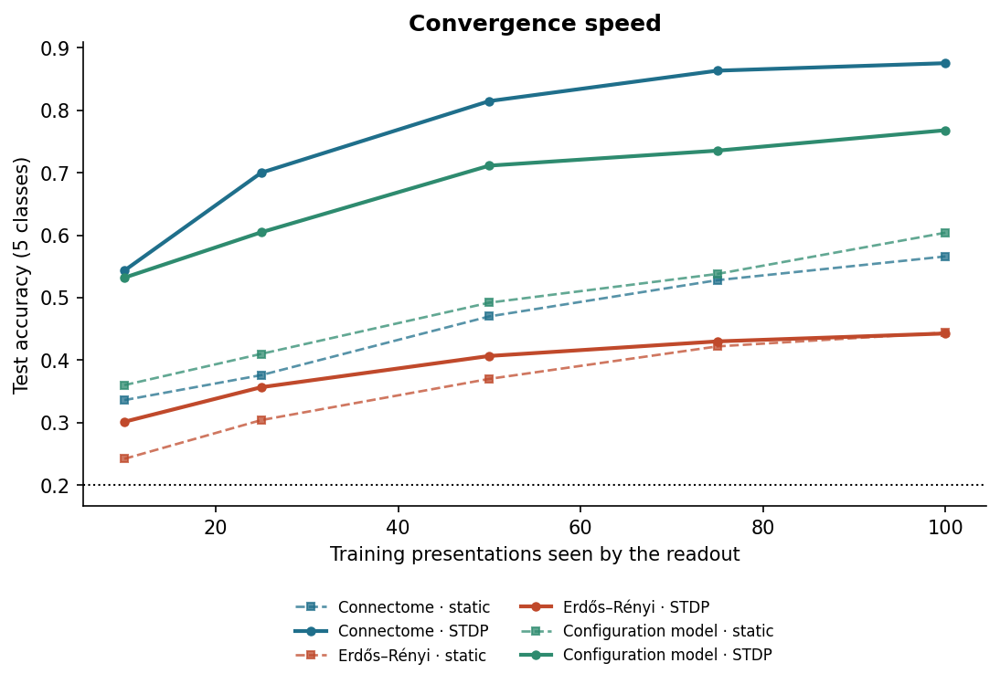
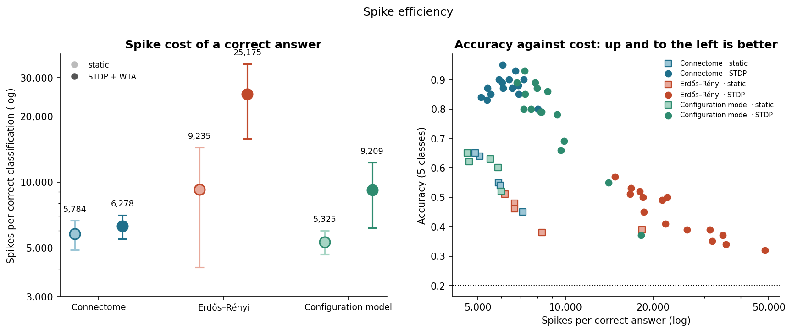
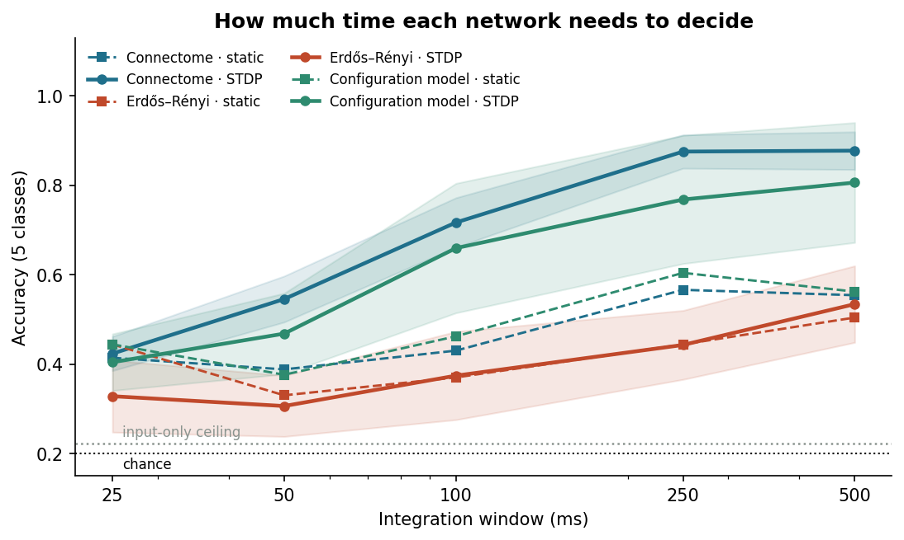
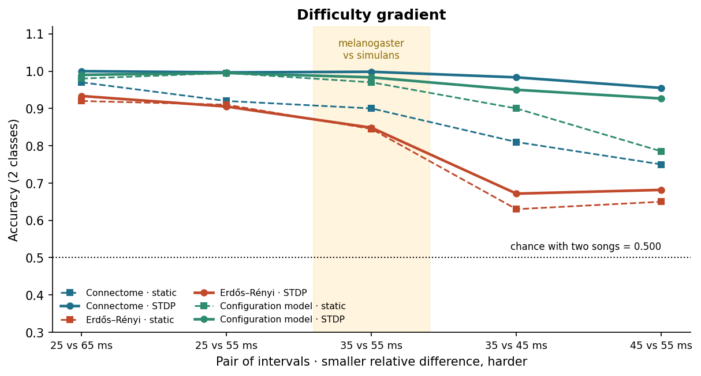
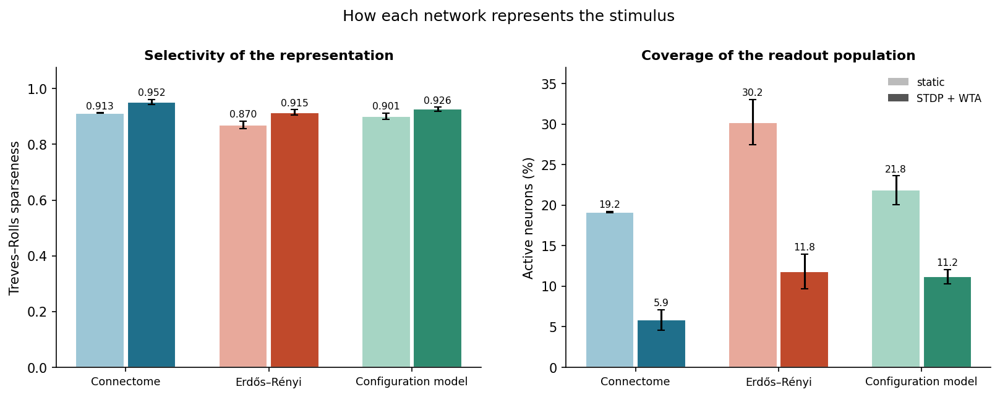
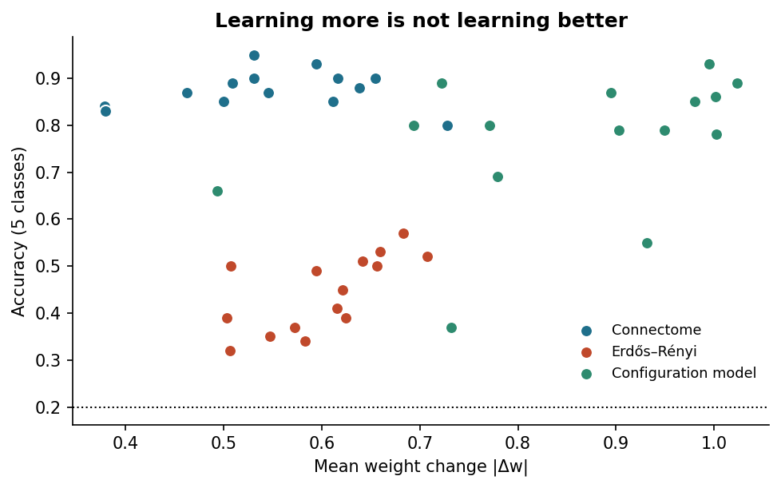

# Phase 05 results: comparative evaluation of the three wirings

Notebook: [`01-comparative-evaluation.ipynb`](01-comparative-evaluation.ipynb) · Inputs: [`../04-modeling/outputs/results.json`](../04-modeling/outputs/results.json), [`../04-modeling/outputs/extra_seeds.json`](../04-modeling/outputs/extra_seeds.json), [`../04-modeling/outputs/threshold_sweep.json`](../04-modeling/outputs/threshold_sweep.json), [`../03-data-preparation/outputs/operating_point.json`](../03-data-preparation/outputs/operating_point.json) · Figures: the eight `docs/figures/05-*.png`, shown in their sections

---

## 1. Context and goal

Phase 02 extracted the auditory circuit of **Johnston's organ** (JO), the ear of the fruit fly, from the FlyWire **connectome**, the map of all the neurons of the fly brain and of the connections between them (Dorkenwald et al., 2024). The subgraph has 1,239 neurons and 20,059 connections. Phase 03 turned it into a **spiking neural network** (SNN), a network whose neurons communicate with brief electrical events called **spikes**, and calibrated it. Phase 04 ran the experiment and stored every result.

This phase evaluates. We organize the project by the phases of CRISP-DM (Chapman et al., 2000), and this is its evaluation phase, which in the KDD (knowledge discovery in databases) process corresponds to interpretation and evaluation (Fayyad et al., 1996). The research question is whether a spiking network wired like the connectome and trained with a local learning rule beats networks with equivalent artificial wiring. Our evaluation objective is to compare the spiking networks with one another in accuracy, learning speed, spike efficiency, selectivity and weight stability. The notebook of this phase brings all those measures together and decides, with statistics, which wiring solves the auditory task best and at what cost. It runs no simulation.

The networks are built from **leaky integrate-and-fire** neurons, which add up their input current, leak it slowly and fire when their voltage crosses a threshold. They learn with **spike-timing-dependent plasticity** (STDP), a local rule that strengthens a connection when the sending neuron fires just before the receiving one and weakens it when it fires just after (Song et al., 2000). **Winner-take-all** (WTA) inhibition holds the network back when many neurons fire at once, so that a few of them specialize.

We compare three **topologies**, or wirings. Everything else is shared, from the number of neurons and of connections of each sign to the weight distribution, the input layer, the stimuli, the neuron model, the plasticity rule and the readout. So is the **operating point**, a mean firing rate of 10 Hz that phase 03 matched in every network before learning.

| Topology | What it keeps from the connectome |
|---|---|
| **Connectome** | the real wiring (FlyWire v783) |
| Erdős–Rényi | the number of neurons and of connections (Erdős & Rényi, 1959) |
| Configuration model | also, almost exactly, the degree sequence, how many connections enter and leave each neuron (Molloy & Reed, 1995; Newman et al., 2001) |

Each topology runs without plasticity (static) and with STDP + WTA. The static arms have neither, so the effect of plasticity in this report is that of STDP and the WTA layer together. Each of these six combinations is an experimental **arm**, and each arm is repeated with several **seeds**, the numbers that fix the random generators so that a run can be repeated exactly. The arms with plasticity have fifteen seeds and the static arms five.

**The input-only ceiling is 0.223.** Before comparing architectures we measured how much the input layer solves on its own, by applying the same readout to the 123 input neurons with no network in between. It barely beats chance, so any accuracy above that value is computed by the network.

---

## 2. How to read the numbers

**The task.** The networks have to tell apart five versions of the fly's courtship song whose **inter-pulse interval** (IPI), the time between consecutive song pulses, is 25, 35, 45, 55 or 65 ms. The IPI is one of the cues a female uses to recognize males of her species (Bennet-Clark & Ewing, 1969). Our network covers only the first stage of the song pathway, and in the fly the selectivity for the interval appears further downstream (Baker et al., 2022; Zhou et al., 2015). The task is therefore a proxy that we impose on this circuit, not a function known to happen there.

**Two scales of accuracy.** A **linear readout**, a logistic regression (Pedregosa et al., 2011), names the song from the number of spikes that each of the 1,116 neurons without direct input fired. Its **five-class accuracy** is the fraction of test presentations it names correctly. Guessing would get one in five right, so the **chance level** is 0.200. Section 8 uses **pairwise accuracy**, where the readout only has to tell two songs apart. That is an easier question, with a chance level of 0.500. The two scales are never compared with each other. Each number in this report is read against the chance level of its own scale, and every table says which one applies.

**Statistics.** Means are given ± the standard deviation across seeds (sample formula). A **paired comparison** sets two arms side by side seed by seed, so that the random draws are shared and only the factor of interest changes. We test it with a two-sided paired t-test on the seeds the two arms share, which gives five pairs when a static arm is involved and fifteen when both arms learn. The **p-value** is the probability of a difference at least this large if there were none, and we call a difference significant when p < 0.05. A one-way **ANOVA** (analysis of variance) tests whether the three topologies differ within one plasticity condition. The **effect size** is Cohen's d, the difference between two means in units of their pooled standard deviation (Cohen, 1988/2013). Here the pooled variance is the average of the population variances of the two arms. The differences Δ and the values of d use every seed of each arm, while the t-test uses only the shared seeds. **The p-values are not corrected for multiple comparisons.** All tests use SciPy (Virtanen et al., 2020).

---

## 3. Classification accuracy

Five-class task, integration window of 250 ms. **Chance = 0.200. Input-only ceiling = 0.223.**

| Arm | n | Accuracy | Rate (Hz) | Spikes per correct classification | Selectivity |
|---|---|---|---|---|---|
| **Connectome · STDP + WTA** | 15 | **0.875 ± 0.039** | 17.74 | **6,278** | 0.952 |
| Configuration model · STDP + WTA | 15 | 0.768 ± 0.148 | 21.54 | 9,209 | 0.926 |
| Configuration model · static | 5 | 0.604 ± 0.050 | 10.32 | 5,325 | 0.901 |
| Connectome · static | 5 | 0.566 ± 0.082 | 10.38 | 5,784 | 0.913 |
| Erdős–Rényi · static | 5 | 0.444 ± 0.057 | 12.74 | 9,235 | 0.870 |
| Erdős–Rényi · STDP + WTA | 15 | 0.443 ± 0.080 | 33.94 | 25,175 | 0.915 |

The rate is the mean firing rate of the 1,239 neurons of the circuit during the test, not the calibration rate. The 50 neurons of the WTA pool are not counted. The arms with plasticity move away from the 10 Hz operating point as they learn, which is why accuracy has to be read together with the spikes per correct classification (Section 6). Selectivity is explained in Section 9.

The effect of topology is significant in both plasticity conditions. The ANOVA gives F = 8.39, p = 0.005 among the static arms and **F = 76.38, p < 0.00001** among the plastic ones.

Light bars are the static arms and dark bars the arms with STDP + WTA, with error bars of ± one standard deviation. The dashed line is chance and the dotted line the input-only ceiling.

### The connectome with plasticity beats the other five arms

Contrasts paired by seed:

| Comparison | Δ accuracy | p | Cohen's d |
|---|---|---|---|
| vs Erdős–Rényi + STDP | **+0.433** | **< 0.00001** | 7.14 |
| vs Erdős–Rényi, static | **+0.431** | **0.00011** | 9.67 |
| vs connectome **without** STDP | **+0.309** | **0.0047** | 5.31 |
| vs configuration model, static | **+0.271** | **0.0016** | 6.56 |
| vs **configuration model + STDP** | **+0.107** | **0.0167** | 1.02 |

The last row is the decisive one. The configuration model keeps, almost exactly, the degree sequence of the connectome and only rewires where the connections go. It therefore rules out the most obvious alternative explanation, that the advantage comes from a few neurons with very many connections. A recent preprint, not yet peer reviewed, argues that topology advantages reported for connectome-constrained networks can disappear against such degree-preserving controls (Dhiman, 2026). With the first five seeds this difference was +0.156 and did not reach significance (p = 0.17). With fifteen it does. The ten extra seeds were added after that first result, and on them alone the connectome leads by +0.083, with p = 0.0593.

---

## 4. The interaction between topology and plasticity

This is the central finding of the project. Topology and plasticity are the two factors of the design, and there is an **interaction** between them when the effect of one depends on the level of the other.

| Topology | Static | STDP + WTA | Δ | p |
|---|---|---|---|---|
| **Connectome** | 0.566 | **0.875** | **+0.309** | **0.0047** |
| Configuration model | 0.604 | 0.768 | +0.164 | 0.213 |
| Erdős–Rényi | 0.444 | 0.443 | −0.001 | 0.706 |

**The networks have identical size, density and weight distribution, and they learn with the same rule and the same parameters. Only the biological wiring improves significantly.** On the degree-preserving control the improvement exists but is not significant, and on the random network there is none. A direct test of the interaction compares the gains seed by seed, on the five seeds that the static and plastic arms share. It confirms the interaction against the random network (+0.330, p = 0.0114) but not against the degree-preserving control (+0.194, p = 0.0988). Without plasticity the configuration model is even slightly ahead of the connectome. With plasticity the order flips.

The answer to the research question is thus more specific than the hypothesis we started from. The structure of the wiring does more than carry the signal better. **It appears to decide whether local learning finds a useful solution**, most clearly against the random network.

The +0.309 compares the fifteen plastic seeds with the five static ones. On the five seeds both arms share, which are the ones the test uses, the gain is +0.314.

The left panel draws each topology from static to plastic, and the lines of the connectome and of the configuration model cross. The right panel sorts the gains by size and marks the significant one.

---

## 5. Convergence speed

**Convergence** is how quickly the readout learns. The network itself always learns from all 100 presentations; only the readout sees fewer. The training set has 100 presentations, 20 per song. We train the readout on the first 10, 25, 50, 75 and 100 of them and test it each time on the same test set. Five-class accuracy, chance = 0.200.

| Arm | 10 | 25 | 50 | 75 | 100 | 90 % of its final value |
|---|---|---|---|---|---|---|
| **Connectome · STDP** | **0.543** | **0.700** | **0.815** | **0.863** | **0.875** | 50 |
| Configuration model · STDP | 0.532 | 0.605 | 0.711 | 0.735 | 0.768 | 50 |
| Configuration model · static | 0.360 | 0.410 | 0.492 | 0.538 | 0.604 | 100 |
| Connectome · static | 0.336 | 0.376 | 0.470 | 0.528 | 0.566 | 75 |
| Erdős–Rényi · static | 0.242 | 0.304 | 0.370 | 0.422 | 0.444 | 75 |
| Erdős–Rényi · STDP | 0.301 | 0.357 | 0.407 | 0.430 | 0.443 | 50 |

The columns give the accuracy after each number of training presentations, averaged over the seeds of the arm. The notebook draws these curves and prints the last column.

**The connectome with plasticity is ahead at all five points of the curve.** With only ten presentations it already reaches 0.543, more than either of the two Erdős–Rényi networks reaches with all hundred.

The last column needs care. Reaching "90 % of its final value" is a threshold **relative to each network**, so a poor network crosses it early without that meaning anything. Erdős–Rényi with plasticity crosses it with the same 50 presentations as the connectome, only its final value is 0.443. What carries information is the height of the curve, not when it levels off.

---

## 6. Spike efficiency

**Spike efficiency** is measured by the **spikes per correct classification**, all the spikes that the 1,239 neurons of the circuit fire during the test divided by the number of correct answers. On event-driven neuromorphic chips such as Loihi, energy is spent only when spikes occur (Davies et al., 2018; Schuman et al., 2022), so this count is a natural proxy for the activity a network needs.

| Arm | Spikes per correct classification |
|---|---|
| Configuration model · static | **5,325** |
| Connectome · static | 5,784 |
| **Connectome · STDP + WTA** | **6,278** |
| Configuration model · STDP | 9,209 |
| Erdős–Rényi · static | 9,235 |
| Erdős–Rényi · STDP | 25,175 |

Among the arms with plasticity the connectome is by far the most efficient. **It needs 4.0 times fewer spikes than the random network for twice the accuracy**, and 31.8 % fewer than the degree-preserving control while being more accurate.

The static connectome and the static configuration model spend fewer spikes than the connectome with plasticity, but they are much less accurate. Static Erdős–Rényi is not cheaper at all. Of the six arms, the connectome with plasticity offers the best balance between accuracy and cost.

The left panel gives the spikes per correct answer, mean ± standard deviation, on a logarithmic axis. The right panel has one point per run, accuracy against cost, so the best networks sit at the top left.

These are spike counts compared between spiking networks. They are not an energy comparison with conventional networks, which phase 04 makes in its [comparison with conventional networks](../04-modeling/results.md#11-comparison-with-conventional-networks), and which comes out against the spiking networks.

---

## 7. Latency

**Latency** here is accuracy as a function of the **integration window**, the length of the response that the readout counts before deciding. It is the axis of difficulty of the task. It is also the latency that matters for a low-power device, where a shorter window means fewer spikes, less energy and less delay. Five-class task, **chance = 0.200**.

| Arm | 25 ms | 50 ms | 100 ms | 250 ms | 500 ms |
|---|---|---|---|---|---|
| **Connectome · STDP** | 0.423 | 0.545 | 0.717 | **0.875** | 0.877 |
| Configuration model · STDP | 0.404 | 0.468 | 0.659 | 0.768 | 0.806 |
| Configuration model · static | 0.444 | 0.376 | 0.462 | 0.604 | 0.562 |
| Connectome · static | 0.414 | 0.388 | 0.430 | 0.566 | 0.554 |
| Erdős–Rényi · static | 0.444 | 0.330 | 0.370 | 0.444 | 0.504 |
| Erdős–Rényi · STDP | 0.328 | 0.306 | 0.374 | 0.443 | 0.534 |

Two curves grow steadily, the connectome and the degree-preserving control, both with plasticity. Only the connectome's **levels off within the range**. It rises from 0.423 to 0.875 between 25 and 250 ms and gains almost nothing more with twice the time (0.877 at 500 ms). The degree-preserving control is still rising at the end of the range, so at 250 ms it has not reached its plateau yet.

There is a plausible mechanical reading. A 250 ms window holds between about four song pulses (at an interval of 65 ms) and ten (at 25 ms), enough evidence to estimate a rhythm.

The other four curves dip between 25 and 50 ms and then rise more slowly and less regularly, to end between 0.504 and 0.562 at 500 ms. At 25 ms every arm sits between 0.328 and 0.444, well above chance, and the order between arms there says little. From 50 ms on, the connectome with plasticity leads the whole curve.

The shaded bands are the spread across seeds of the plastic arms (± one standard deviation, population formula).

---

## 8. Difficulty gradient

Here the readout only chooses between **two** songs, not among five, so **the chance level of this section is 0.500**. These are pairwise accuracies, and they are not compared with the five-class accuracies of Sections 3 and 7. The five pairs come from the same responses, by restricting the readout to two classes, with no new simulation.

What orders the pairs from left to right is not the difference in milliseconds but the **relative difference**. The last two pairs are both 10 ms apart. Ten milliseconds on a base of 35 is 29 % of the interval, and on a base of 45 only 22 %. This is Weber's law, by which what is registered of a change is its proportion, not its absolute size (Gibbon, 1977). The series runs from 160 % for 25 vs 65 ms down to 22 %.

| Arm | 25 vs 65 | 25 vs 55 | 35 vs 55 | 35 vs 45 | 45 vs 55 |
|---|---|---|---|---|---|
| **Connectome · STDP** | **1.000** | **0.997** | **0.998** | **0.983** | **0.955** |
| Configuration model · STDP | 0.990 | 0.995 | 0.983 | 0.950 | 0.927 |
| Configuration model · static | 0.980 | 0.995 | 0.970 | 0.900 | 0.785 |
| Connectome · static | 0.970 | 0.920 | 0.900 | 0.810 | 0.750 |
| Erdős–Rényi · STDP | 0.933 | 0.905 | 0.848 | 0.672 | 0.682 |
| Erdős–Rényi · static | 0.920 | 0.910 | 0.845 | 0.630 | 0.650 |

Pairwise accuracy, chance = 0.500. Static arms: 5 seeds; arms with STDP: 15.

The pair **35 vs 55 ms** sets a song typical of *D. melanogaster*, whose interval is about 34 ms, against one in the range reported for *D. simulans*, 50 to 65 ms (Bennet-Clark & Ewing, 1969; Deutsch et al., 2019). **The connectome with plasticity tells them apart with an accuracy of 0.998.** On the hardest pair, 45 vs 55 ms, it keeps 0.955, while the random network with plasticity stays at 0.682.

In four of the six arms the hardest pair comes out worse than 35 vs 45 ms, as the relative difference predicts. The two Erdős–Rényi arms are the exception, with the two hard pairs close to each other and the hardest one slightly better.

---

## 9. Representation: selectivity and coverage

Two measures describe how a network represents a song, beyond whether it gets it right. **Selectivity** is the population sparseness of the response of the readout neurons to a presentation, S = [1 − (Σr/n)² / Σ(r²/n)] / (1 − 1/n), where r are the spike counts of the n neurons. It is the normalized Treves–Rolls measure (Treves & Rolls, 1991; Vinje & Gallant, 2000) computed across neurons (Willmore & Tolhurst, 2001). It is 0 when all neurons respond equally and 1 when a single neuron responds. **Coverage** is the percentage of readout neurons that fire at least once during a presentation.

| Arm | Selectivity | Coverage (%) |
|---|---|---|
| Connectome · STDP | **0.952** | 5.851 |
| Configuration model · STDP | 0.926 | 11.176 |
| Erdős–Rényi · STDP | 0.915 | 11.834 |
| Connectome · static | 0.913 | 19.155 |
| Configuration model · static | 0.901 | 21.847 |
| Erdős–Rényi · static | 0.870 | 30.237 |

Plasticity raises selectivity and lowers coverage in all three wirings. The connectome with plasticity reaches the highest selectivity and the lowest coverage of the six arms. On average about 65 of its 1,116 readout neurons fire during a song.

The two numbers are tied. A response spread evenly over that small fraction of neurons would already have a selectivity of about 0.94, so most of the high selectivity comes from how few neurons respond. Selectivity on its own therefore does not show that the neurons have specialized. What we can say is that learning concentrates the response on a small group. In the connectome that small group is also the one that classifies best (Section 3), at the lowest spike cost among the plastic arms (Section 6). The network as a whole stays active, at 17.74 Hz on average. Its activity is concentrated, not low.

---

## 10. Weight stability

| Arm | Mean \|Δw\| | Final drift |
|---|---|---|
| Connectome + STDP | 0.543 | **0.0124** |
| Erdős–Rényi + STDP | 0.602 | 0.0252 |
| Configuration model + STDP | **0.858** | 0.0146 |

Fifteen seeds per arm. The **mean absolute weight change** |Δw| says how far learning moved the weights, and the **drift** of the mean weight over the last 20 % of training says whether they were still moving at the end. A small drift means that learning settled.

All three networks change their weights substantially, and all three settle. Only in the connectome does that change bring a significant gain in accuracy. The connectome moves its weights the least and ends with the smallest drift. **It does not learn more. It learns better.**

One point per seed. The connectome and Erdős–Rényi move their weights by similar amounts but sit at very different accuracies, and the configuration model spreads along both axes. How much the weights move does not predict accuracy.

---

## 11. Robustness

We checked the result against the three sources of variation of the design.

**Seeds.** The connectome with plasticity has fifteen independent repetitions. Their mean is 0.875 with a standard deviation of 0.039, they range from 0.800 to 0.950, and **every one** of them beats the input-only ceiling.

**Mapping of filterbank channels onto input neurons.** The 32 channels of the auditory filterbank have to be assigned to the 123 input neurons. We compared four mappings with five seeds each. The default one is anchored to the two vibration-sensitive subgroups of JO neurons (Kamikouchi et al., 2009; Matsuo et al., 2014). JO-B, which prefers low frequencies, takes the low channels, and JO-A, which carries the high-frequency responses, takes the high ones. The others are its inverse, the order of FlyWire identifiers (`root_id`) and a random assignment.

| Mapping | Static | STDP + WTA |
|---|---|---|
| Anchored (JO-B low, JO-A high) | 0.566 ± 0.082 | 0.880 ± 0.048 |
| Anchored, inverted | 0.758 ± 0.044 | 0.900 ± 0.040 |
| `root_id` order | 0.676 ± 0.044 | 0.892 ± 0.016 |
| Random assignment | 0.736 ± 0.045 | 0.920 ± 0.029 |

With all four mappings the connectome with plasticity stays between 0.880 and 0.920, far above the input-only ceiling. The main results use the anchored mapping, which on this task is the **least favorable** of the four for the accuracy of the connectome, with and without plasticity. Only the connectome was run with the four mappings, and the controls used the anchored one. These runs show that the accuracy of the connectome does not depend on the mapping, not that its advantage over the controls does not. Its gain from plasticity also varies, from +0.142 to +0.314 on these five seeds. The anchored arm with plasticity is the main arm on its first five seeds, which the code reproduces exactly, so it gives 0.880 here against 0.875 over fifteen seeds.

**Contact threshold.** The subgraph keeps only connections formed by at least 5 synaptic contacts. We rebuilt it at thresholds of 1, 3, 5 and 10 contacts and recalibrated the operating point at each one. The advantage of the connectome over the random network, both with plasticity, holds across the usable range, with **+0.680** at ≥ 3, **+0.397** at ≥ 5 and **+0.370** at ≥ 10 contacts. These are the values the notebook prints. The sweep compares the connectome only with Erdős–Rényi, with three seeds per arm and no statistical test. At threshold 1 the random network cannot be brought to the common operating point, so that row is not comparable. The details of the sweep are in [Robustness to the contact threshold](../04-modeling/results.md#10-robustness-to-the-contact-threshold) in the phase 04 results.

---

## 12. Conclusions

**The connectome combined with STDP is the best of the three wirings on the auditory task.** It leads in accuracy and representation, and among the arms with plasticity it is also the cheapest in spikes.

1. **Accuracy.** It reaches 0.875 ± 0.039 and beats each of the other five arms with statistical significance, including the control that keeps, almost exactly, the degree sequence (+0.107, p = 0.0167, d = 1.02).
2. **Spike efficiency.** It needs 6,278 spikes per correct answer against the 25,175 of the random network with the same plasticity, four times fewer for twice the accuracy. The two static arms that spend fewer spikes are much less accurate.
3. **Representation.** Its response is the most selective and the most concentrated of the six arms. Selectivity alone does not prove specialization, but the small group of neurons that carries the response is also the one that classifies best.

It also brings a finding that was not in the starting hypothesis. **Plasticity pays off significantly only on the biological wiring.** The same rule, with the same parameters, is applied to networks of identical size, density and weight distribution. It significantly improves the connectome (+0.309, p = 0.0047) and leaves the random network where it was (−0.001, p = 0.706). Its gain on the degree-preserving control is about half as large and not significant, and the direct test of the interaction against that control does not reach significance (p = 0.0988).

The pair of songs that sets a typical *D. melanogaster* interval against one in the range of *D. simulans* is told apart with an accuracy of 0.998, against a two-class chance level of 0.500.

The accuracy of the connectome holds across seeds, channel mappings and contact thresholds, within the limits listed below, and it is always measured against a known input-only ceiling. The accuracy reported is computed by the network, not information that arrived already solved.

---

## Scope and limitations

**Scope.** This phase compares **the three spiking networks with one another**, which is what our evaluation objective asks. The comparison with conventional, second-generation neural networks is in the phase 04 [comparison with conventional networks](../04-modeling/results.md#11-comparison-with-conventional-networks), and it marks how far the conclusions reach. On this task a linear classifier is cheaper, because a subgraph of 1,239 neurons is oversized for a five-class problem. The energy advantage of spiking networks is motivation taken from the literature (Roy et al., 2019; Schuman et al., 2022), not a result of this work.

**Limitations.**

- **The task is a proxy.** The selectivity of the fly for the inter-pulse interval appears downstream of the circuit we model (Section 2).
- **The operating point is matched before learning, not after.** The arms with plasticity end between 17.74 and 33.94 Hz, against 10.32 to 12.74 Hz for the static ones, so accuracy has to be read together with the spikes per correct classification.
- **The readout is linear.** A non-linear decoder could extract structure that logistic regression misses, and not necessarily to the same degree in every topology.
- **Five intervals, one carrier, synthetic songs.** The result should be checked with other carriers and with recorded natural songs.
- **No synaptic delays.** All transmission is instantaneous. In a temporal task, delays proportional to anatomical distance would give the spatial structure of the connectome an extra dynamic consequence.
- **The advantage over the degree-preserving control is the narrowest** (+0.107). It is significant, but it should always be reported with its effect size.
- **The p-values are not corrected for multiple comparisons.** Over the five contrasts of the connectome with plasticity, the Holm procedure keeps all of them below 0.05. The stricter Bonferroni correction raises the decisive one to 0.0836 (Section 1 of the notebook).
- **The interaction is significant against one control only.** Tested directly, it holds against the random network (p = 0.0114) but not against the degree-preserving control (p = 0.0988), whose gain rests on five paired seeds.
- **Seeds added after a first result.** The plastic arms went from five to fifteen seeds after a non-significant first contrast with the degree-preserving control. On the ten added seeds alone the connectome leads by +0.083, with p = 0.0593.
- **Plasticity comes with the WTA layer.** No static arm has the winner-take-all inhibition, so the gain from plasticity is that of STDP and that inhibition together.
- **Spike counts leave out the WTA pool.** They cover the 1,239 neurons of the circuit, not the 50 interneurons of the plastic arms.
- **The robustness checks cover part of the comparison.** The channel mappings were run only on the connectome, and the threshold sweep compares it only with the random network.
- **Selectivity and coverage summarize the response; they do not show what each neuron encodes** (Section 9).

---

## Next steps: from the fly to low-power devices

This project looks for a path toward **edge AI**, machine learning that runs inside small, battery-powered sensors instead of sending the data to the cloud. Spiking networks are good candidates because, on event-driven hardware, they spend energy only when something happens (Schuman et al., 2022). This section explains what the results suggest for getting there, and what is better left aside. None of it is a result of this repository.

### What we actually learned

The song of the fly is the **test bench, not the application**. What the project suggests is more general, although it rests on one circuit and one task, so it is a hypothesis to test.

> With the same number of neurons, **a well-organized wiring plus a local learning rule (STDP)** recognizes *how often a beat repeats* in a signal better than a random wiring does.

We do not yet know over what range of rhythms this holds. The neurons and synapses of the model act on time scales of milliseconds to tens of milliseconds, and the intervals we tested go from 25 to 65 ms. We expect the advantage to hold for beats that repeat every few tens of milliseconds and to fade for rhythms of hundreds of milliseconds, such as the beat of a piece of music. That is a hypothesis to test.

On energy we have to be clear. Per decision, at the same accuracy (0.880), the cheapest conventional network, a linear classifier, spends **461 times less** than our network. In the model, silence costs our network nothing if no input spikes arrive. A conventional network with a switch that turns it off when there is no signal would also spend almost nothing. With what we measured, **an energy advantage cannot be claimed**, and it would have to be measured on the complete device.

### Real-world signals with the same shape

- **Vibrating machines.** When a bearing of a motor is damaged, every turn produces a small impact, and the time between impacts reveals which part failed. Case Western Reserve University keeps a widely used public benchmark of bearing recordings (Case Western Reserve University Bearing Data Center, n.d.; Smith & Randall, 2015). With the motor turning at 1,797 rpm, the impacts come about every 6 ms when the inner race is damaged, 9 ms for the outer race and 7 ms for a rolling element. Those intervals are shorter than the 25 to 65 ms we tested, so the first question is whether the effect carries over to faster rhythms. Vibration sensors are wireless, run on batteries and spend most of their time measuring a healthy machine, which is where a spiking network could save energy. Early detection of machine faults is a representative industrial use case for ultra-low-power machine learning (Banbury et al., 2021).
- **Insects and frogs.** Crickets, katydids and frogs recognize the calls of their own species partly by how fast the pulses repeat, much as the fly does (Bush et al., 2009; Schöneich et al., 2015; Ward et al., 2013). Field sensors running on batteries or solar panels could use this to **monitor crop pests and measure biodiversity**.
- **What does not fit yet.** Heartbeats, footsteps or tremors repeat every few hundred milliseconds. If the advantage fades at that scale, as we expect, they would need slower neurons, and that is another project.

### Five steps, from the simplest to the most ambitious

**A. Check whether it works outside the fly** *(1–2 months, no new hardware).* Take public recordings of healthy and faulty motors and turn the vibration into spikes, the way we now turn sound into spikes. Then repeat **exactly the same experiment**. Same three networks, with and without learning, same seeds, same statistics. This step decides everything else. If the connectome with plasticity wins again, the principle works outside biology. If it does not, the result marks a second limit of the effect and the work turns toward step E. One caveat. We expect conventional networks to do very well on these recordings, so the argument would not be higher accuracy but lower cost and the ability to adapt without help.

**B. Shrink the network** *(1–2 months, alongside A).* The current network has 1,239 neurons for a problem with five options. It is like using a truck to deliver a letter, and it is the main reason why the conventional network comes out 461 times cheaper. The idea is to remove parts of the circuit step by step and measure when the advantage is lost, until only the **minimal circuit** that keeps it remains. The goal is to see whether it fits in a few hundred neurons. Shrinking is also a practical requirement, since low-power neuromorphic chips such as SynSense's Xylo Audio support about 1,000 neurons (SynSense, 2022).

**C. Run it on a real chip and measure fairly** *(3–6 months).* So far the energy has been estimated with published figures (Davies et al., 2018; Horowitz, 2014). The next step is to measure it. We would run the reduced network on the simulator of a commercial neuromorphic chip, and on the physical board if the budget allows. Xylo Audio is one candidate, with the open-source Python library Rockpool (Bos & Muir, 2023). The comparison should be with the right rival, a small conventional network on a typical microcontroller, **also with a switch for silence**. The question then stops being "how much does one decision cost?" and becomes **"how long does the battery of the sensor last?"**

**D. Let the device adapt by itself, without labels** *(2–3 months, after A).* This is the strongest argument for a spiking network in a small device. Conventional networks learn by backpropagation, which exceeds the memory of typical microcontrollers and becomes feasible only with specialized co-design (Lin et al., 2022). When conditions change, such a network is usually retrained on a computer and installed again. STDP updates each weight using only the spike times of the two neurons it connects, and it needs nobody to say which answer is correct. In the experiment we would train the readout with the motor at one load, change the load and let STDP readjust on unlabeled data. If accuracy holds, the result is **a sensor that calibrates itself to each machine without human intervention**. Here the central finding of this work matters directly, because plasticity only worked on the wiring of the connectome.

**E. Use the connectome as a design recipe, not as a copy** *(6–12 months, a research line).* Today the network copies 1,239 neurons of the fly brain literally. It cannot change size, and it exists only for this circuit. Yet the results already hint at **which part of the wiring matters**.

*The hint.* The configuration model keeps how many connections each neuron has but draws at random where they go. With that it reaches 0.768, against the 0.875 of the connectome. The number of connections explains a good part of the result, but not all of it. The missing +0.107 is most likely due to **how the connections are organized**. Phase 02 measured what that random draw destroys, on one wiring of each control (seed 0).

| Property | Connectome | Erdős–Rényi | Configuration model |
|---|---|---|---|
| Groups of tightly connected neurons (modularity Q) | **0.3524** | 0.1528 | 0.1307 |
| Neighbors in common (mean clustering coefficient) | **0.1835** | 0.0260 | 0.0963 |
| Two-way connections (reciprocity) | **0.1287** | 0.0147 | 0.0450 |

Modularity measures how strongly a network splits into groups that are densely connected inside and sparsely connected to each other. The clustering coefficient is the probability that two neighbors of a neuron are also connected, as when A talks to B, B talks to C and A also talks to C. Reciprocity is the fraction of connections from A to B that also have a connection back from B to A. The random draw of the configuration model leaves modularity even below that of the random network. That loss of organization is our main candidate for the missing +0.107.

A city makes a useful comparison. Copying the exact map of a city works for that city and nothing else. Learning **the planning rules** that make it work, its neighborhoods, roundabouts and two-way streets, lets one design new cities of any size.

*The experiment.* We would build artificial networks that add those properties one at a time. First only the number of connections, then the groups, then the two-way connections, then the neighbors in common. Then we would measure which of them recover the +0.107. The result would be a **recipe**, a short list of rules that produces networks that behave like the connectome without copying it.

*Why it would scale.*

1. **To any size.** With the recipe one could generate a network of 200 neurons for a tiny sensor or of 10,000 for a larger device, without needing a piece of brain of exactly that size. One concrete way to grow is to repeat the biological module once per frequency band. Auditory systems do map sound frequency in an orderly way (tonotopy), from the human auditory cortex (Saenz & Langers, 2014) to the first auditory stages of the fly (Patella & Wilson, 2018). The current subgraph has five natural groups (Louvain communities) of 188 to 279 neurons, and 3.8 input neurons per frequency channel (123 over 32 channels). Copying it whole as a module would give these sizes.

   | Goal | Copies | Resulting network |
   |---|---|---|
   | 32 channels (current) | ×1 | 1,239 neurons · 20,059 connections |
   | 64 channels | ×2 | 2,478 neurons · 40,118 connections |
   | 128 channels | ×4 | 4,956 neurons · 80,236 connections |
   | 128 channels, twice the neurons per channel | ×8 | 9,912 neurons · 160,472 connections |

   If each module were the minimal circuit of step B instead of the full subgraph, all those figures would shrink in the same proportion. Widening the frequency band is the easy part. [`snnlib/audio.py`](../snnlib/audio.py) fixes `F_MIN = 80` and `F_MAX = 380` Hz, and its sampling rate of 44,100 Hz already covers much more.
2. **To other tasks.** The fly brain has other circuits already mapped, for motion vision, smell or balance. Each could give its own recipe. If the recipes agree, there is a general principle. If not, we get a catalog, with one recipe for vibration and sound, another for moving images and another for odors that could serve electronic noses.
3. **To any chip.** The recipe can be fitted to the limits of each piece of hardware, such as its maximum number of neurons or of connections per neuron. There is no need to force a piece of brain into a space where it does not fit.
4. **To other brains.** We could test the recipe on the connectome of the male fly central nervous system (Berg et al., 2026) and on a cubic millimeter of mouse visual cortex (MICrONS Consortium et al., 2025). That would tell whether it belongs to the fly or to brains in general. The male connectome comes from a male fly, so comparing it with ours would also test sexual dimorphism, not only repeat the experiment.

It is the difference between saying "this network works for fly songs" and saying **"this method builds efficient networks for signals with a rhythm"**.

### In what order

- **A and B at the same time.** Together they decide whether the applied line has a future.
- **If A works, C and D.** Together they give a prototype of a vibration sensor that lasts longer on its battery and calibrates itself.
- **E in parallel**, as a research line. If A fails, E becomes the main path.

### What we leave aside

- Simulating the whole fly brain, about 139,000 neurons (Dorkenwald et al., 2024), for edge AI. It is the opposite of a small device. It makes sense for neuroscience, not for a sensor.
- Generic tasks with no rhythm, such as classifying still images or transcribing continuous speech.
- Claiming energy savings per decision against a conventional network.

> None of this changes the conclusions above. The declared scope is still the comparison of the three spiking networks with one another, and the energy advantage over second-generation networks is still not claimed. This section describes how it could be put to the test, not a result we obtained.

---

## References

- Baker, C. A., McKellar, C., Pang, R., Nern, A., Dorkenwald, S., Pacheco, D. A., Eckstein, N., Funke, J., Dickson, B. J., & Murthy, M. (2022). Neural network organization for courtship-song feature detection in *Drosophila*. *Current Biology, 32*(15), 3317–3333.e7. https://doi.org/10.1016/j.cub.2022.06.019
- Banbury, C., Janapa Reddi, V., Torelli, P., Jeffries, N., Kiraly, C., Holleman, J., Montino, P., Kanter, D., Warden, P., Pau, D., Thakker, U., Torrini, A., Cordaro, J., Di Guglielmo, G., Duarte, J., Tran, H., Tran, N., Niu, W., & Xu, X. (2021). MLPerf Tiny benchmark. In *Proceedings of the Neural Information Processing Systems Track on Datasets and Benchmarks* (Vol. 1). https://datasets-benchmarks-proceedings.neurips.cc/paper/2021/hash/da4fb5c6e93e74d3df8527599fa62642-Abstract-round1.html
- Bennet-Clark, H. C., & Ewing, A. W. (1969). Pulse interval as a critical parameter in the courtship song of *Drosophila melanogaster*. *Animal Behaviour, 17*(4), 755–759. https://doi.org/10.1016/S0003-3472(69)80023-0
- Berg, S., Beckett, I. R., Costa, M., Schlegel, P., Januszewski, M., Marin, E. C., Nern, A., Preibisch, S., Qiu, W., Takemura, S.-y., Fragniere, A. M. C., Champion, A. S., Adjavon, D.-Y., Cook, M., Gkantia, M., Hayworth, K. J., Huang, G. B., Katz, W. T., Kämpf, F., . . . Jefferis, G. S. X. E. (2026). Sexual dimorphism in the complete *Drosophila* male central nervous system connectome. *Cell, 189*(18), 5504–5526.e15. https://doi.org/10.1016/j.cell.2026.08.015
- Bos, H., & Muir, D. (2023). Sub-mW neuromorphic SNN audio processing applications with Rockpool and Xylo. In *Embedded artificial intelligence: Devices, embedded systems, and industrial applications* (pp. 69–78). River Publishers. https://doi.org/10.1201/9781003394440-7
- Bush, S. L., Beckers, O. M., & Schul, J. (2009). A complex mechanism of call recognition in the katydid *Neoconocephalus affinis* (Orthoptera: Tettigoniidae). *Journal of Experimental Biology, 212*(5), 648–655. https://doi.org/10.1242/jeb.024786
- Case Western Reserve University Bearing Data Center. (n.d.). *Bearing information*. Retrieved October 14, 2026, from https://engineering.case.edu/bearingdatacenter/bearing-information
- Chapman, P., Clinton, J., Kerber, R., Khabaza, T., Reinartz, T., Shearer, C., & Wirth, R. (2000). *CRISP-DM 1.0: Step-by-step data mining guide*. SPSS Inc. https://web.archive.org/web/20060207174803/http://www.crisp-dm.org/CRISPWP-0800.pdf
- Cohen, J. (2013). *Statistical power analysis for the behavioral sciences* (2nd ed.). Routledge. https://doi.org/10.4324/9780203771587 (Original work published 1988)
- Davies, M., Srinivasa, N., Lin, T.-H., Chinya, G., Cao, Y., Choday, S. H., Dimou, G., Joshi, P., Imam, N., Jain, S., Liao, Y., Lin, C.-K., Lines, A., Liu, R., Mathaikutty, D., McCoy, S., Paul, A., Tse, J., Venkataramanan, G., . . . Wang, H. (2018). Loihi: A neuromorphic manycore processor with on-chip learning. *IEEE Micro, 38*(1), 82–99. https://doi.org/10.1109/MM.2018.112130359
- Deutsch, D., Clemens, J., Thiberge, S. Y., Guan, G., & Murthy, M. (2019). Shared song detector neurons in *Drosophila* male and female brains drive sex-specific behaviors. *Current Biology, 29*(19), 3200–3215.e5. https://doi.org/10.1016/j.cub.2019.08.008
- Dhiman, N. (2026). *Topological sensitivity in connectome-constrained neural networks* (arXiv:2604.04033) [Preprint]. arXiv. https://doi.org/10.48550/arXiv.2604.04033
- Dorkenwald, S., Matsliah, A., Sterling, A. R., Schlegel, P., Yu, S.-c., McKellar, C. E., Lin, A., Costa, M., Eichler, K., Yin, Y., Silversmith, W., Schneider-Mizell, C., Jordan, C. S., Brittain, D., Halageri, A., Kuehner, K., Ogedengbe, O., Morey, R., Gager, J., . . . The FlyWire Consortium. (2024). Neuronal wiring diagram of an adult brain. *Nature, 634*(8032), 124–138. https://doi.org/10.1038/s41586-024-07558-y
- Erdős, P., & Rényi, A. (1959). On random graphs I. *Publicationes Mathematicae Debrecen, 6*(3–4), 290–297. https://doi.org/10.5486/PMD.1959.6.3-4.12
- Fayyad, U., Piatetsky-Shapiro, G., & Smyth, P. (1996). From data mining to knowledge discovery in databases. *AI Magazine, 17*(3), 37–54. https://doi.org/10.1609/aimag.v17i3.1230
- Gibbon, J. (1977). Scalar expectancy theory and Weber’s law in animal timing. *Psychological Review, 84*(3), 279–325. https://doi.org/10.1037/0033-295X.84.3.279
- Horowitz, M. (2014). 1.1 Computing’s energy problem (and what we can do about it). In *2014 IEEE International Solid-State Circuits Conference Digest of Technical Papers (ISSCC)* (pp. 10–14). IEEE. https://doi.org/10.1109/ISSCC.2014.6757323
- Kamikouchi, A., Inagaki, H. K., Effertz, T., Hendrich, O., Fiala, A., Göpfert, M. C., & Ito, K. (2009). The neural basis of *Drosophila* gravity-sensing and hearing. *Nature, 458*(7235), 165–171. https://doi.org/10.1038/nature07810
- Lin, J., Zhu, L., Chen, W.-M., Wang, W.-C., Gan, C., & Han, S. (2022). On-device training under 256KB memory. In *Advances in Neural Information Processing Systems 35* (pp. 22941–22954). https://doi.org/10.52202/068431-1667
- Matsuo, E., Yamada, D., Ishikawa, Y., Asai, T., Ishimoto, H., & Kamikouchi, A. (2014). Identification of novel vibration- and deflection-sensitive neuronal subgroups in Johnston’s organ of the fruit fly. *Frontiers in Physiology, 5*, Article 179. https://doi.org/10.3389/fphys.2014.00179
- MICrONS Consortium, Bae, J. A., Baptiste, M., Baptiste, M. R., Bishop, C. A., Bodor, A. L., Brittain, D., Brooks, V., Buchanan, J., Bumbarger, D. J., Castro, M. A., Celii, B., Cobos, E., Collman, F., da Costa, N. M., Danskin, B., Dorkenwald, S., Elabbady, L., Fahey, P. G., . . . Zhang, C. (2025). Functional connectomics spanning multiple areas of mouse visual cortex. *Nature, 640*(8058), 435–447. https://doi.org/10.1038/s41586-025-08790-w
- Molloy, M., & Reed, B. (1995). A critical point for random graphs with a given degree sequence. *Random Structures & Algorithms, 6*(2–3), 161–180. https://doi.org/10.1002/rsa.3240060204
- Newman, M. E. J., Strogatz, S. H., & Watts, D. J. (2001). Random graphs with arbitrary degree distributions and their applications. *Physical Review E, 64*(2), Article 026118. https://doi.org/10.1103/PhysRevE.64.026118
- Patella, P., & Wilson, R. I. (2018). Functional maps of mechanosensory features in the *Drosophila* brain. *Current Biology, 28*(8), 1189–1203.e5. https://doi.org/10.1016/j.cub.2018.02.074
- Pedregosa, F., Varoquaux, G., Gramfort, A., Michel, V., Thirion, B., Grisel, O., Blondel, M., Prettenhofer, P., Weiss, R., Dubourg, V., Vanderplas, J., Passos, A., Cournapeau, D., Brucher, M., Perrot, M., & Duchesnay, É. (2011). Scikit-learn: Machine learning in Python. *Journal of Machine Learning Research, 12*, 2825–2830. https://jmlr.org/papers/v12/pedregosa11a.html
- Roy, K., Jaiswal, A., & Panda, P. (2019). Towards spike-based machine intelligence with neuromorphic computing. *Nature, 575*(7784), 607–617. https://doi.org/10.1038/s41586-019-1677-2
- Saenz, M., & Langers, D. R. M. (2014). Tonotopic mapping of human auditory cortex. *Hearing Research, 307*, 42–52. https://doi.org/10.1016/j.heares.2013.07.016
- Schöneich, S., Kostarakos, K., & Hedwig, B. (2015). An auditory feature detection circuit for sound pattern recognition. *Science Advances, 1*(8), Article e1500325. https://doi.org/10.1126/sciadv.1500325
- Schuman, C. D., Kulkarni, S. R., Parsa, M., Mitchell, J. P., Date, P., & Kay, B. (2022). Opportunities for neuromorphic computing algorithms and applications. *Nature Computational Science, 2*(1), 10–19. https://doi.org/10.1038/s43588-021-00184-y
- Smith, W. A., & Randall, R. B. (2015). Rolling element bearing diagnostics using the Case Western Reserve University data: A benchmark study. *Mechanical Systems and Signal Processing, 64–65*, 100–131. https://doi.org/10.1016/j.ymssp.2015.04.021
- Song, S., Miller, K. D., & Abbott, L. F. (2000). Competitive Hebbian learning through spike-timing-dependent synaptic plasticity. *Nature Neuroscience, 3*(9), 919–926. https://doi.org/10.1038/78829
- SynSense. (2022). *Xylo Audio datasheet*. https://www.synsense.ai/wp-content/uploads/2023/06/Xylo-Audio-datasheet.pdf
- Treves, A., & Rolls, E. T. (1991). What determines the capacity of autoassociative memories in the brain? *Network: Computation in Neural Systems, 2*(4), 371–397. https://doi.org/10.1088/0954-898X_2_4_004
- Vinje, W. E., & Gallant, J. L. (2000). Sparse coding and decorrelation in primary visual cortex during natural vision. *Science, 287*(5456), 1273–1276. https://doi.org/10.1126/science.287.5456.1273
- Virtanen, P., Gommers, R., Oliphant, T. E., Haberland, M., Reddy, T., Cournapeau, D., Burovski, E., Peterson, P., Weckesser, W., Bright, J., van der Walt, S. J., Brett, M., Wilson, J., Millman, K. J., Mayorov, N., Nelson, A. R. J., Jones, E., Kern, R., Larson, E., . . . Vázquez-Baeza, Y. (2020). SciPy 1.0: Fundamental algorithms for scientific computing in Python. *Nature Methods, 17*(3), 261–272. https://doi.org/10.1038/s41592-019-0686-2
- Ward, J. L., Buerkle, N. P., & Bee, M. A. (2013). Spatial release from masking improves sound pattern discrimination along a biologically relevant pulse-rate continuum in gray treefrogs. *Hearing Research, 306*, 63–75. https://doi.org/10.1016/j.heares.2013.09.006
- Willmore, B., & Tolhurst, D. J. (2001). Characterizing the sparseness of neural codes. *Network: Computation in Neural Systems, 12*(3), 255–270. https://doi.org/10.1080/net.12.3.255.270
- Zhou, C., Franconville, R., Vaughan, A. G., Robinett, C. C., Jayaraman, V., & Baker, B. S. (2015). Central neural circuitry mediating courtship song perception in male *Drosophila*. *eLife, 4*, Article e08477. https://doi.org/10.7554/eLife.08477
